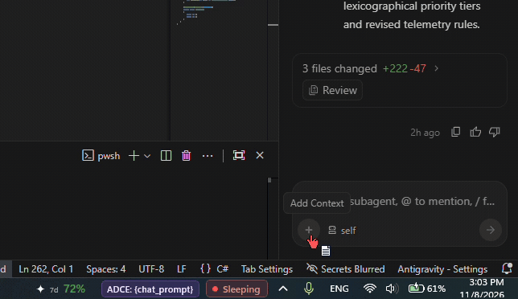
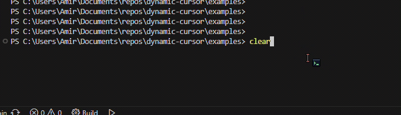
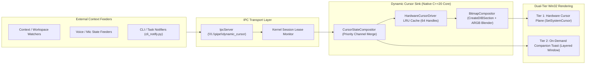

<!-- SPDX-License-Identifier: Apache-2.0 -->
<!-- Copyright (c) 2026 Amir Farhadi -->

# Dynamic Cursor

**Dynamic Cursor** is an event-driven, hardware-accelerated Windows pointer compositor and visual state sink. Rather than coupling cursor logic to a single application, it acts as a generalized rendering daemon that any external tool can drive in real time over local IPC (`\\.\pipe\dynamic_cursor`).

Dynamic Cursor is fully standalone with no hard dependencies on external software. External feeders can push visual state layers to the cursor in real time. Dynamic Cursor arbitrates layer priorities, composites 32-bit ARGB bitmaps in memory, and renders shapes, color tints, corner badges, compact loading bars, and pop-out micro-notifications with zero polling loops and zero display stutter. For existing ecosystem integrations, jump to [Integrations](#integrations).

<p align="center">
  
</p>

<p align="center">
  
</p>

---

## Architecture Overview



---

## Key Capabilities

1. **Pure Actuator Decoupling**: The core engine contains zero external domain logic. External feeders push visual state layers over a Named Pipe with kernel-backed connection leases.
2. **In-Memory Procedural Compositing**: Generates 32-bit pre-multiplied ARGB bitmaps in RAM via `CreateDIBSection` and `CreateIconIndirect` in under 45 microseconds without pre-baking static `.cur` files.
3. **Multi-Channel Priority Arbitration**: Merges orthogonal channels (`base_shape`, `tint_rgba`, `corner_badge`, `progress_bar`, `toast`) across concurrent feeders based on explicit layer priorities.
4. **Kernel Lease Auto-Rollback**: Binds active layers to the feeder's connection handle. If a feeder process terminates unexpectedly, the Windows Object Manager signals `ERROR_BROKEN_PIPE`, purging associated layers in 940 microseconds.
5. **Dual-Tier Rendering Backend**:
   - **Tier 1 (Hardware Cursor Plane)**: Drives a `64x64` ARGB hardware canvas with sub-55 us cached swap latency, zero motion lag, and zero CPU usage during mouse movement.
   - **Tier 2 (On-Demand Companion Overlay)**: Spawns click-through, non-activating layered windows (`WS_EX_LAYERED | WS_EX_TRANSPARENT | WS_EX_NOACTIVATE`) for wider text notifications and loading bars without persistent mouse hooks.
6. **Dual Distribution Targets**: Runs as a compact standalone system tray daemon (`dynamic-cursor-tray.exe`, 96 KB binary, 1.64 MB private working set) or as an in-process Windhawk mod (`dynamic-cursor.wh.cpp`) intercepting `user32!SetCursor`.

---

## Building from Source

### Prerequisites

- Windows 10/11 x64
- MSVC 19.50+ (Visual Studio 2022 / Build Tools)
- Windows 11 SDK (`10.0.26100.0` or newer)
- CMake 3.31+
- Ninja build system
- Python 3.10+ (for Python feeder SDK and test suites)

### Build Commands

```pwsh
# Configure the build directory using Ninja
cmake -B build -G Ninja

# Compile the standalone tray daemon and native core test runner
cmake --build build --config Release
```

The compiled binaries are placed in `build/`:
- `build/dynamic-cursor-tray.exe`: Production standalone system tray daemon.
- `build/test_native_core.exe`: Native unit test runner.

---

## Standalone Tray Daemon Usage

Launch the daemon from PowerShell:

```pwsh
# Start daemon with default system tray icon
.\build\dynamic-cursor-tray.exe

# Start daemon in headless dry-run mode for automated testing
.\build\dynamic-cursor-tray.exe --no-tray --dry-run-cursor --pipe "\\.\pipe\dynamic_cursor_test"
```

### Command Line Options

| Flag | Parameter | Default Value | Description |
| :--- | :--- | :--- | :--- |
| `--pipe` | Path | `\\.\pipe\dynamic_cursor` | Win32 Named Pipe path for IPC connections. |
| `--no-tray` | None | Disabled | Runs without creating a system tray icon. |
| `--dry-run-cursor` | None | Disabled | Skips live `SetSystemCursor` calls for headless testing. |
| `--canvas-size` | Integer | `64` | Hardware cursor canvas dimension in pixels (`64` or `128`). |

---

## Windhawk Mod Installation

The Windhawk mod injects into user processes to intercept `user32!SetCursor` calls, ensuring custom cursor states remain visible even inside applications that bypass global system slots.

1. Open the Windhawk application.
2. Navigate to **Advanced** > **Create Local Mod**.
3. Name the mod `dynamic-cursor`.
4. Copy the contents of [`src/windhawk/dynamic-cursor.wh.cpp`](src/windhawk/dynamic-cursor.wh.cpp) into the editor.
5. Click **Compile Mod** to verify compilation and activate the mod.

Refer to [`src/windhawk/README.md`](src/windhawk/README.md) for configuration details.

---

## Python Feeder SDK Quickstart

The repository provides an idiomatic Python feeder client in `src/dynamic_cursor/client.py`.

```python
from dynamic_cursor.client import DynamicCursorClient

# Connect to the local cursor daemon
with DynamicCursorClient() as client:
    # Assert a listening microphone indicator (any producer can use any layer id)
    client.set_layer(
        layer_id="mic_state",
        priority=80,
        base_shape="default_arrow",
        tint_rgba="#44FF66",
        badge_id="mic_on",
    )

    # Display a completion toast
    client.show_toast("Recognition active", duration_ms=1500)
```

---

## Command Line Interface (CLI)

The Python client includes a command-line interface executable via `python -m dynamic_cursor.client`:

```pwsh
# Assert a visual layer and hold the connection lease for 10 seconds
python -m dynamic_cursor.client set --layer mic --priority 80 --tint "#FF5555" --badge mic_off --hold 10

# Transmit a layer using high-speed 32-byte binary framing
python -m dynamic_cursor.client set --layer sniper --priority 90 --shape precision_cross --binary

# Trigger an ephemeral progress bar with a 4-second TTL
python -m dynamic_cursor.client set --layer build --priority 60 --progress 0.65 --ttl 4000

# Display an ephemeral companion toast notification
python -m dynamic_cursor.client toast "Build completed: 42 targets compiled" --duration 2500

# Remove an asserted layer
python -m dynamic_cursor.client clear --layer mic

# Purge all layers asserted by this connection
python -m dynamic_cursor.client clear-all
```

### Task Progress & Build Notifier Example

The companion utility [`examples/cli_notify.py`](examples/cli_notify.py) demonstrates streaming task progress percentages directly to the cursor indicator during command execution:

```pwsh
# Run simulated build task with dynamic cursor progress and completion toast
python examples/cli_notify.py --steps 25 --delay 0.06
```

---

## Running Verification Tests

### 1. Native Core Unit Test Suite

Verifies binary and JSON serialization, multi-channel priority composition, LRU cache eviction, handle safety, overlay styles, and lease auto-rollback:

```pwsh
.\build\test_native_core.exe
```

### 2. End-to-End Daemon Integration Suite

Verifies live named pipe streaming, concurrent feeder priority resolution, kernel lease auto-rollback on feeder crash, and private working set memory limits:

```pwsh
pytest tests/test_e2e_daemon.py -v
```

---

## Living Documentation Index

- **Context & Domain Model**: [`docs/CONTEXT.md`](docs/CONTEXT.md)
- **Living Requirements**: [`docs/requirements/living_requirements.md`](docs/requirements/living_requirements.md)
- **Prior Art & Open Source Audit**: [`docs/requirements/prior_art_audit.md`](docs/requirements/prior_art_audit.md)
- **System Architecture Spec**: [`docs/architecture/01_system_architecture.md`](docs/architecture/01_system_architecture.md)
- **Win32 Subsystem Deep Dive**: [`docs/architecture/02_win32_subsystem_deep_dive.md`](docs/architecture/02_win32_subsystem_deep_dive.md)
- **IPC Wire Protocol & Feeder SDK**: [`docs/architecture/03_ipc_wire_protocol_and_sdk.md`](docs/architecture/03_ipc_wire_protocol_and_sdk.md)
- **Living Roadmap**: [`docs/roadmap/living_roadmap.md`](docs/roadmap/living_roadmap.md)
- **Exploratory Vision**: [`docs/roadmap/exploratory_vision.md`](docs/roadmap/exploratory_vision.md)

---

## Repository Safety & Hygiene

This repository enforces pre-commit interception and CI gates against local paths, secrets, and binary blobs:
- **Safety Scanner**: [`scripts/check_repo_safety.py`](scripts/check_repo_safety.py)
- **CI Workflow**: [`.github/workflows/ci.yml`](.github/workflows/ci.yml)

Run the safety scanner manually:
```pwsh
python scripts/check_repo_safety.py
```

---

## Integrations

Dynamic Cursor operates as a standalone daemon and does not require any of the projects below. These projects demonstrate external feeders that push visual state over the named pipe:

| Project | Role | Description |
| :--- | :--- | :--- |
| [Caster Dynamic Cursor Plugin](https://github.com/amirf147/caster-plugins/tree/main/plugins/dynamic_cursor) | Voice Control / Mic States | Bridges speech recognition engine modes and microphone states to the cursor. A standalone reference implementation is provided in [`examples/caster_mic_feeder.py`](examples/caster_mic_feeder.py). |
| [Active Desktop Context Engine (ADCE)](https://github.com/amirf147/active-desktop-context-engine) | Desktop Context Graph | Projects semantic focus zones, active window context, and container badges to the cursor. |

To list your integration here, submit a pull request updating this table.

---

## License

Licensed under the Apache License, Version 2.0. See [`LICENSE`](LICENSE) for details.

Copyright (c) 2026 Amir Farhadi.
