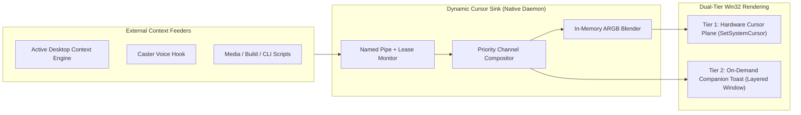

<!-- SPDX-License-Identifier: Apache-2.0 -->
<!-- Copyright (c) 2026 Amir Farhadi -->

# Dynamic Cursor

**Dynamic Cursor** is an event-driven, hardware-accelerated Windows mouse pointer compositor and visual state sink. Rather than coupling cursor changes to a single application, it acts as a minimal, generalized rendering daemon that any external tool can drive in real time over local IPC (`\\.\pipe\dynamic_cursor`).

External feeders (such as an Active Desktop Context Engine, Caster voice recognition, browser media watchers, or build scripts) push visual state layers to the cursor. Dynamic Cursor arbitrates layer priorities, composites 32-bit ARGB bitmaps in memory, and renders shapes, color tints, corner badges, compact loading bars, and pop-out micro-notifications with zero polling loops and zero display stutter.

---

## Current Status & Direction

The project is in the **empirical discovery and architectural prototyping phase**. Specifications and roadmaps are maintained as living documents and kept intentionally adaptable as low-level Win32 micro-spikes validate hardware boundaries.

### Immediate Engineering Focus
1. **Pure Actuator Decoupling**: Keep `dynamic-cursor` blind to workspace logic; external tools push state layers over a Named Pipe with kernel-backed connection leases.
2. **In-Memory Procedural Compositing**: Use `CreateDIBSection` and `CreateIconIndirect` to dynamically tint cursors and stamp corner badges or mini progress bars in RAM without pre-baking static `.cur` files.
3. **Two-Tier Cursor Area Extension**:
   - **Tier 1 (Hardware Cursor Canvas)**: Test expanded ARGB hardware cursor bitmaps (`64x64` to `128x128` px) to attach zero-lag status indicators, corner badges, and compact loading bars directly to the GPU cursor plane.
   - **Tier 2 (On-Demand Companion Overlay)**: Test click-through layered windows (`UpdateLayeredWindow` / Direct2D) for wider pop-out text notifications and extended progress bars without global `WH_MOUSE_LL` hooks.
4. **Native C/C++ & Windhawk Exploration**: Target an ultra-lightweight native Win32 C++20 binary (`< 2 MB` RAM) that can run either as a standalone System Tray daemon or as a Windhawk mod.

---

## Architecture Overview



---

## Living Documentation Index

- **Context & Domain Model**: [`docs/CONTEXT.md`](docs/CONTEXT.md)
- **Living Requirements**: [`docs/requirements/living_requirements.md`](docs/requirements/living_requirements.md)
- **Prior Art & Open Source Audit**: [`docs/requirements/prior_art_audit.md`](docs/requirements/prior_art_audit.md)
- **System Architecture Spec**: [`docs/architecture/01_system_architecture.md`](docs/architecture/01_system_architecture.md)
- **Win32 Subsystem Deep Dive (Area Extension & Compositing)**: [`docs/architecture/02_win32_subsystem_deep_dive.md`](docs/architecture/02_win32_subsystem_deep_dive.md)
- **Living Roadmap (Discovery Spikes & Near-Term Tasks)**: [`docs/roadmap/living_roadmap.md`](docs/roadmap/living_roadmap.md)
- **Exploratory Vision (C/C++, Windhawk, Ecosystem)**: [`docs/roadmap/exploratory_vision.md`](docs/roadmap/exploratory_vision.md)

---

## Repository Safety & Hygiene

This repository enforces pre-commit interception and CI gates against local paths, secrets, and binary blobs:
- **Pre-commit Configuration**: [`.pre-commit-config.yaml`](.pre-commit-config.yaml)
- **Safety Scanner**: [`scripts/check_repo_safety.py`](scripts/check_repo_safety.py)
- **CI Workflow**: [`.github/workflows/ci.yml`](.github/workflows/ci.yml)

Run the safety scanner manually:
```pwsh
py -3.10 scripts/check_repo_safety.py
```

---

## License

Licensed under the Apache License, Version 2.0. See [`LICENSE`](LICENSE) for details.

Copyright (c) 2026 Amir Farhadi.
