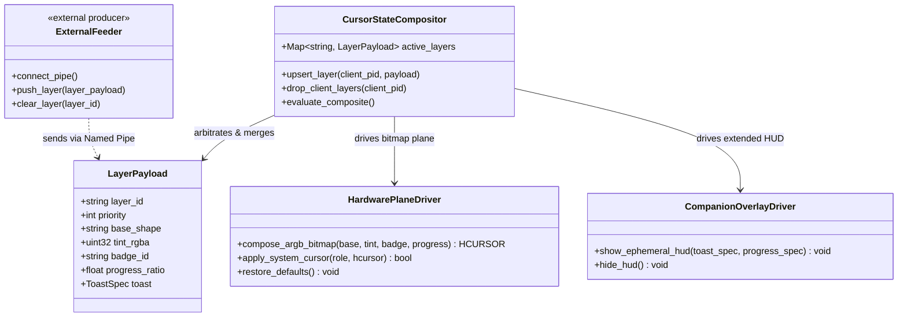

<!-- SPDX-License-Identifier: Apache-2.0 -->
<!-- Copyright (c) 2026 Amir Farhadi -->

# Dynamic Cursor: Context & Domain Model

## 1. System Mission & Scope

Dynamic Cursor is a generalized, event-driven Windows pointer compositor and visual state sink. Its primary responsibility is to dynamically modify mouse pointer shapes, sizes, color tints, attached corner badges, loading indicators, and micro-notifications in real time based on external commands, without relying on periodic polling loops or inducing display stutter.

Rather than embedding workspace observation logic inside the cursor tool, Dynamic Cursor operates as a minimal, standalone actuator listening over local IPC (`\\.\pipe\dynamic_cursor`). Any external producer (such as an Active Desktop Context Engine, Caster voice recognition, browser media watchers, build scripts, or accessibility utilities) can push visual state layers to the cursor in real time.

---

## 2. Living Documentation Charter

All documents in this repository are living documents. Technical assumptions, requirement specifications, architectural boundaries, and implementation roadmaps are intentionally kept adaptable so empirical micro-spikes can guide downstream architecture choices.

### Documentation Index
- **Architecture**:
  - [System Architecture](architecture/01_system_architecture.md): Decoupled feeder-to-sink model, state priority compositor, dual rendering paths, and native C++20 dual-target architecture.
  - [Win32 Subsystem Deep Dive](architecture/02_win32_subsystem_deep_dive.md): In-memory bitmap composition (`CreateIconIndirect`), hardware cursor plane size limits, companion overlay mechanics (Mode A and Mode B), and `user32!SetCursor` interception.
- **Empirical Spikes & Telemetry**:
  - [Spike 01: Hardware Cursor Canvas & Latency](spikes/report_01_hardware_canvas.md): Validates `64x64` / `128x128` hardware canvas fidelity, sub-55 us cached swap latency, and 15-frame progress bar animation.
  - [Spike 02: Companion Overlay Architecture](spikes/report_02_companion_overlay.md): Evaluates Mode A (Spawn-Anchored Toast, 0.35 ms median spawn) vs Mode B (Raw Input Follower, 74 us repositioning) and proves focus preservation and click-through invariants.
  - [Spike 03: Named Pipe Leases & State Compositor](spikes/report_03_named_pipe_leases.md): Benchmarks length-prefixed IPC throughput (21,768 msg/s, 25 us latency) and proves 940 us kernel lease rollback on process crash.
  - [Spike 04: Native C++20 Toolchain & Windhawk](spikes/report_04_native_toolchain.md): Host compiler discovery (MSVC 19.50, WinSDK 10.0.26100, Windhawk Clang 20.1), binary footprint (256 KB .exe, 1.33 MB private working set), and Windhawk mod interception mapping.
- **Requirements**:
  - [Living Requirements](requirements/living_requirements.md): Functional and non-functional requirements, feeder integration stories, and acceptance criteria.
  - [Prior Art & Web Audit](requirements/prior_art_audit.md): Comparative analysis of existing open-source cursor changers, PowerToys overlays, and historical failure modes.
- **Roadmap & Explorations**:
  - [Living Roadmap](roadmap/living_roadmap.md): Phase 1 empirical completion metrics, Phase 2 native C++20 implementation tasks, and exploratory vision queue.
  - [Exploratory Vision](roadmap/exploratory_vision.md): Deep dive into C/C++ native packaging, Windhawk mod distribution, and procedural cursor capabilities.

---

## 3. Core Domain Ontology

### Domain Definitions
- **Cursor Sink (Actuator)**: The core `dynamic-cursor` process. It has zero knowledge of external applications and strictly renders the composite result of active state layers.
- **External Feeder (Producer)**: Any external process (Active Desktop Context Engine, Caster, CLI script) that connects to `\\.\pipe\dynamic_cursor` to assert or clear visual state layers.
- **Connection Lease**: Kernel-tracked lifetime binding between an external feeder's open pipe handle and its asserted cursor layers. If the feeder process crashes or exits, the Windows Object Manager closes the handle table, signaling `ERROR_BROKEN_PIPE` in under 1.0 ms (empirically 940 us) to automatically purge all associated layers.
- **Hardware Cursor Canvas**: A 32-bit pre-multiplied ARGB bitmap standardized at `64x64` pixels (and expandable to `128x128`) created in memory via `CreateDIBSection` and `CreateIconIndirect`. Rendered directly by the GPU hardware cursor plane with zero motion lag and sub-55 us cached swap latency.
- **Extended Companion Area**: An on-demand, click-through Layered / DirectComposition window (`WS_EX_LAYERED | WS_EX_TRANSPARENT | WS_EX_NOACTIVATE`) spawned near the pointer only when visual elements exceed hardware cursor canvas dimensions (such as multi-word text notifications or expanded progress bars). Operates via Mode A (Spawn-Anchored Toast, 0% hooks, 0.0% CPU when holding) or Mode B (On-Demand Raw Input Follower, 74 us repositioning, 0% lingering hooks).

---

## 4. Engineering Invariants & Boundaries

1. **Zero Polling Invariant**:
   Polling loops (`while True: sleep(...)` or periodic timers) are strictly prohibited. All transitions are triggered by incoming IPC packets or OS kernel wait handles.
2. **In-Memory Hardware Swapping**:
   Dynamic runtime transitions for shapes, tints, and corner badges execute in memory via `CreateIconIndirect` and `user32.SetSystemCursor`. Registry modification paired with `SPIF_SENDCHANGE` is forbidden during runtime switches.
3. **Handle Duplication Protocol**:
   Because `SetSystemCursor` destroys the handle passed to it, the engine never passes a cached master handle directly. It always passes a duplicate created via `CopyIcon`.
4. **On-Demand Overlay Lifecycle**:
   When the Extended Companion Area is inactive, zero mouse-tracking hooks (`WM_INPUT` or WinEvents) may remain registered.
5. **Guaranteed Restoration**:
   On process exit, crash interception, or unload, the engine executes `SystemParametersInfoW(SPI_SETCURSORS, 0, None, 0)` to restore the operating system default cursor scheme.
