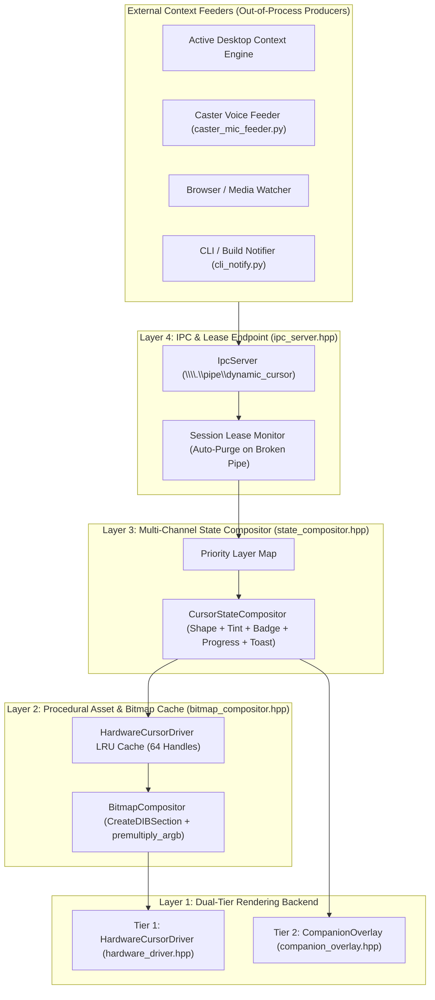
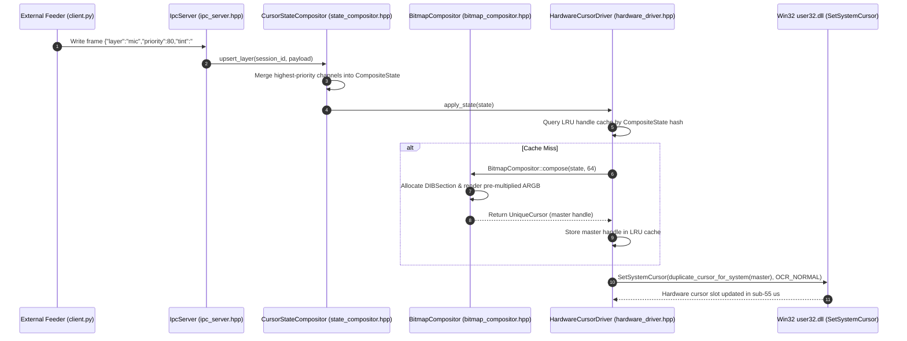
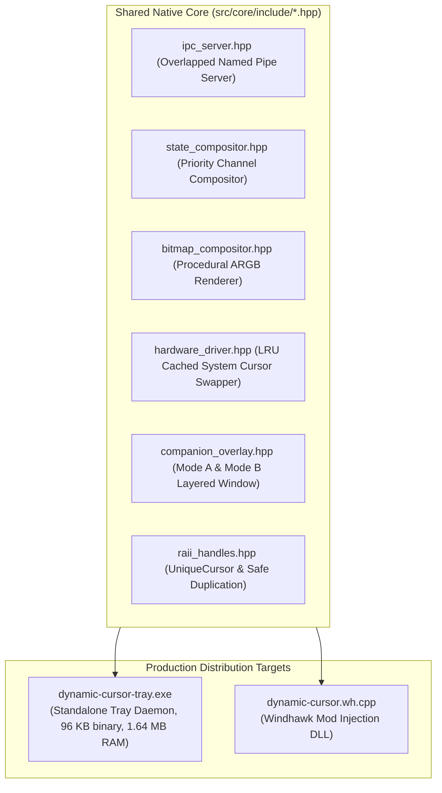

<!-- SPDX-License-Identifier: Apache-2.0 -->
<!-- Copyright (c) 2026 Amir Farhadi -->

# System Architecture Specification

## 1. Architectural Philosophy

Dynamic Cursor separates context detection (Feeders) from visual actuation (The Cursor Sink). The core `dynamic-cursor` engine knows nothing about microphones, window titles, web browsers, or build systems. It operates strictly as a high-speed visual state server that accepts layer payloads over local IPC, arbitrates priorities, composites bitmaps in memory, and drives both the Windows Hardware Cursor Plane and an on-demand Extended Companion Overlay.

---

## 2. Layer Definitions & Contracts

### Layer 4: IPC & Lease Endpoint (`IpcServer`)
An asynchronous Win32 Named Pipe server implemented in [`src/core/include/ipc_server.hpp`](../../src/core/include/ipc_server.hpp) that listens on `\\.\pipe\dynamic_cursor` using non-blocking overlapped I/O:
- **Wire Framing**: Every frame begins with a fixed 4-byte unsigned 32-bit little-endian integer (`uint32_t`) specifying payload byte length, followed by either a 32-byte packed binary struct (`BinaryPacket`) or a UTF-8 JSON payload. Detailed framing specifications and byte offsets are documented in [IPC Wire Protocol & Feeder SDK](03_ipc_wire_protocol_and_sdk.md).
- **Kernel Connection Leases**: Each connected feeder session receives a unique `client_session_id`. When a feeder process terminates unexpectedly or closes its pipe handle, the Windows kernel Object Manager closes the handle table, signaling `ERROR_BROKEN_PIPE` to the server in under 1.0 ms (empirically measured at 940 us). Layer 4 immediately purges all layers registered by that session and triggers an atomic state re-evaluation.
- **Stateless One-Shot Mode**: Short-lived CLI scripts can push a layer with an explicit `ttl_ms` (time-to-live) for transient notifications, loading bars, or temporary alerts without maintaining persistent connections.

### Layer 3: Multi-Channel State Compositor (`CursorStateCompositor`)
Implemented in [`src/core/include/state_compositor.hpp`](../../src/core/include/state_compositor.hpp). Unlike basic cursor utilities that swap whole static files, the compositor breaks cursor appearance into independent visual channels:

| Visual Channel | Example Values | Resolution Rule Across Priorities |
| :--- | :--- | :--- |
| **`base_shape`** | `default_arrow`, `precision_cross`, `reading_minimal` | Highest priority layer defining `base_shape` wins. |
| **`tint_rgba`** | `#44FF66` (listening green), `#FF5555` (sleeping red) | Highest priority layer defining `tint_rgba` wins. |
| **`corner_badge`** | `tv_icon`, `mic_off`, `vim_normal` | Highest priority layer defining `corner_badge` is stamped into the bottom-right quadrant. |
| **`progress_bar`** | `0.0` to `1.0` (compact bar or radial ring) | Rendered beneath or beside the pointer while active. |
| **`extended_toast`** | `{"text": "Build completed", "duration_ms": 2500}` | Routed to Tier 2 Extended Companion Overlay. |

Because channels are orthogonal, Caster can assert `tint_rgba: red` at Priority 80 while an external Context Engine asserts `corner_badge: tv_icon` at Priority 20. The compositor merges both into a single red pointer with a TV badge in the bottom-right corner in approximately 25 microseconds.

### Layer 2: Procedural Asset & Bitmap Cache (`BitmapCompositor`)
Implemented in [`src/core/include/bitmap_compositor.hpp`](../../src/core/include/bitmap_compositor.hpp). Manages base cursor shapes, badge sprites, and procedural ARGB buffers in RAM:
- **Zero Disk Thrashing**: Base cursors and mini-icons are generated directly in memory.
- **In-Memory Composition**: Combines the winning `base_shape`, `tint_rgba`, `corner_badge`, and compact `progress_bar` into a 32-bit pre-multiplied ARGB DIB section (`CreateDIBSection`) and converts it into an `HCURSOR` via `CreateIconIndirect`.
- **Pre-Multiplied Alpha Requirement**: GDI and DWM cursor scanout require strict pre-multiplied ARGB channels (`premultiply_argb(a, r, g, b)`). Straight alpha produces dark halo fringing against bright desktop backgrounds.
- **Handle Duplication Protocol**: Master handles are managed via RAII wrappers (`UniqueCursor` in [`src/core/include/raii_handles.hpp`](../../src/core/include/raii_handles.hpp)). The engine always passes a duplicate created via `duplicate_cursor_for_system` (`CopyIcon`) to `SetSystemCursor` because Windows takes ownership of and destroys the handle passed to it.

### Layer 1: Dual-Tier Rendering Backend
Splits rendering between the hardware cursor plane (for zero-lag attached indicators) and an on-demand layered window (for wider text and HUD elements):
1. **Tier 1 (`HardwareCursorDriver`)**: Implemented in [`src/core/include/hardware_driver.hpp`](../../src/core/include/hardware_driver.hpp). Pushes the composite `HCURSOR` (`64x64` standardized canvas, expandable to `128x128`) directly into the GPU hardware cursor slot via `SetSystemCursor(OCR_NORMAL)`. It maintains an LRU handle cache of capacity 64 to avoid redundant bitmap composition. Swap latency averages sub-55 us on `64x64` canvases (0.74% of a 144 Hz frame budget). Executes with zero motion lag and zero CPU overhead during mouse movement.
2. **Tier 2 (`CompanionOverlay`)**: Implemented in [`src/core/include/companion_overlay.hpp`](../../src/core/include/companion_overlay.hpp). Spawns a click-through, non-activating layered popup (`WS_EX_LAYERED | WS_EX_TRANSPARENT | WS_EX_NOACTIVATE`) only when an active state requires an extended canvas beyond hardware cursor dimensions:
   - **Mode A (Spawn-Anchored Toast)**: Used for text notifications and transient alerts. Queries `GetCursorPos` once on arrival, spawns near the pointer, animates slide/fade over 200 ms, holds stationary, and fades out. Verified 0.35 ms median spawn latency, 0.0% CPU during hold, and zero installed mouse hooks.
   - **Mode B (On-Demand Raw Input Follower)**: Used for attached continuous HUDs. Registers `RegisterRawInputDevices` (`RIDEV_INPUTSINK`) only while visible, repositions via `SetWindowPos` in 74 to 111 us per `WM_INPUT`, and immediately tears down registration with `RIDEV_REMOVE` on hide. Verified zero lingering hooks and zero focus disruption.

---

## 3. Feeder-to-Sink Sequence Diagram

---

## 4. Teardown & Fail-Safe Recovery

1. Process termination hooks (`atexit`, `SetConsoleCtrlHandler`, `SIGINT`, `SIGTERM`) invoke `SystemParametersInfoW(0x0057, 0, nullptr, 0)` (`SPI_SETCURSORS`) to restore the permanent Windows cursor scheme.
2. On startup, the daemon checks for a single-instance mutex (`Local\DynamicCursorSingleInstanceMutex`) and executes `perform_system_restoration()` to guarantee a clean baseline before accepting feeder connections.

---

## 5. Native C++20 Packaging & Dual-Target Architecture

The repository provides two distribution targets built upon the shared C++20 core:

1. **Standalone System Tray Daemon (`dynamic-cursor-tray.exe`)**:
   - Source: [`src/daemon/main.cpp`](../../src/daemon/main.cpp).
   - Built with MSVC 19.50 (`cl.exe`), CMake 3.31, and Ninja linking standard Win32 libraries (`user32.lib`, `gdi32.lib`, `shell32.lib`).
   - Produces a single compact binary (96 KB) with a 1.64 MB private working set, requiring no external runtime dependencies beyond the Windows Universal CRT.
   - Provides a system tray icon (`Shell_NotifyIcon`) supporting pause/resume toggling, cursor reset, and clean exit.
2. **Windhawk Mod (`dynamic-cursor.wh.cpp`)**:
   - Source: [`src/windhawk/dynamic-cursor.wh.cpp`](../../src/windhawk/dynamic-cursor.wh.cpp).
   - Compiled via Windhawk's bundled Clang 20.1 targeting MinGW-w64 with preconfigured `windhawk_api.h`. Documentation is provided in [`src/windhawk/README.md`](../../src/windhawk/README.md).
   - Intercepts `user32!SetCursor` via `Wh_SetFunctionHook` using trampoline pointers.
   - Solves the application-specific cursor override limitation by intercepting custom cursors passed during `WM_SETCURSOR` inside apps that bypass global `OCR_NORMAL` system slots.
