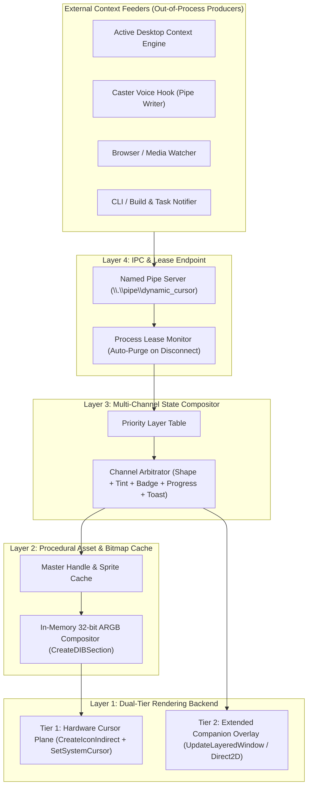
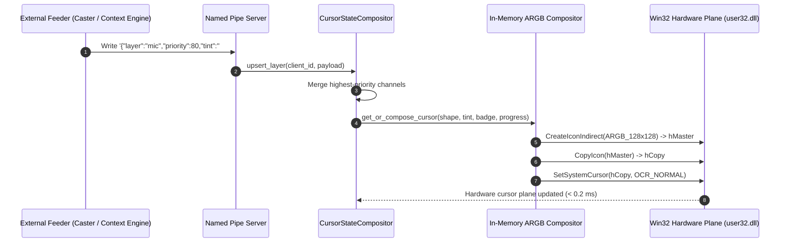

<!-- SPDX-License-Identifier: Apache-2.0 -->
<!-- Copyright (c) 2026 Amir Farhadi -->

# System Architecture Specification

## 1. Architectural Philosophy

Dynamic Cursor separates **context detection (Feeders)** from **visual actuation (The Cursor Sink)**. The core `dynamic-cursor` engine knows nothing about microphones, window titles, web browsers, or build systems. It operates strictly as a high-speed visual state server that accepts layer payloads over local IPC, arbitrates priorities, composites bitmaps in memory, and drives both the Windows Hardware Cursor Plane and an on-demand Extended Companion Overlay.

---

## 2. Layer Definitions & Contracts

### Layer 4: IPC & Lease Endpoint (`\\.\pipe\dynamic_cursor`)
A single asynchronous Named Pipe server that receives structured state payloads from any external program.
- **Connection Leases**: Each connected feeder owns its asserted state layers. If a feeder process terminates unexpectedly or closes its pipe handle, the OS kernel signals `ERROR_BROKEN_PIPE` and Layer 4 immediately removes all layers belonging to that connection.
- **Stateless One-Shot Mode**: Short-lived CLI scripts can also push a layer with an explicit `ttl_ms` (time-to-live) for transient notifications, loading bars, or temporary alerts.

### Layer 3: Multi-Channel State Compositor (`CursorStateCompositor`)
Unlike simple cursor switchers that only swap a whole `.cur` file, the compositor breaks cursor appearance into composable visual channels:

| Visual Channel | Example Values | Resolution Rule Across Priorities |
| :--- | :--- | :--- |
| **`base_shape`** | `default_arrow`, `precision_cross`, `reading_minimal` | Highest priority layer defining `base_shape` wins. |
| **`tint_rgba`** | `#44FF66FF` (listening green), `#FF5555FF` (sleeping red) | Highest priority layer defining `tint_rgba` wins. |
| **`corner_badge`** | `tv_icon`, `mic_muted`, `vim_normal`, `pet_frame_1` | Highest priority layer defining `corner_badge` is stamped into the bottom-right quadrant. |
| **`progress_bar`** | `0.0` to `1.0` (compact bar or radial ring) | Rendered beneath or beside the pointer while active. |
| **`extended_toast`** | `{"text": "Build succeeded", "duration_ms": 1500}` | Routed to Tier 2 Extended Companion Overlay. |

Because channels are orthogonal, Caster can assert `tint_rgba: red` at Priority 80 while the Active Desktop Context Engine asserts `corner_badge: tv_icon` at Priority 20. The compositor merges both into a single red pointer with a TV badge in the bottom-right corner.

### Layer 2: Procedural Asset & Bitmap Cache (`BitmapCompositor`)
Manages base cursor templates, badge sprites, and procedural ARGB buffers in RAM:
- **Zero Disk Thrashing**: Base cursors and mini-icons are loaded into memory once.
- **In-Memory Composition**: Combines the winning `base_shape`, `tint_rgba`, `corner_badge`, and compact `progress_bar` into a 32-bit pre-multiplied ARGB DIB section (`CreateDIBSection`) and converts it into an `HCURSOR` via `CreateIconIndirect`.
- **Handle Duplication Invariant**: Caches the composite `HCURSOR` by state signature and always passes a `CopyIcon` duplicate to `SetSystemCursor`.

### Layer 1: Dual-Tier Rendering Backend
Splits rendering between the hardware cursor plane (for zero-lag attached indicators) and an on-demand layered window (for wider text and HUD elements):
1. **Tier 1 (`HardwareCursorDriver`)**: Pushes the composite `HCURSOR` (`32x32` up to `128x128` pixels) directly into the GPU hardware cursor slot via `SetSystemCursor`. Executes with **0.0 ms motion lag** and **0.0% CPU overhead** during mouse movement.
2. **Tier 2 (`CompanionOverlayDriver`)**: Spawns a click-through, non-activating layered window (`WS_EX_LAYERED | WS_EX_TRANSPARENT | WS_EX_NOACTIVATE`) only when an active state requires an extended canvas beyond hardware cursor dimensions (such as multi-word text notifications or detailed loading bars).

---

## 3. Feeder-to-Sink Sequence Diagram

---

## 4. Teardown & Fail-Safe Recovery

1. Process termination hooks (`atexit`, `SetConsoleCtrlHandler`, `SIGINT`, `SIGTERM`) invoke `SystemParametersInfoW(0x0057, 0, None, 0)` (`SPI_SETCURSORS`) to restore the permanent Windows cursor scheme.
2. On startup, the daemon checks for a stale lock marker from any prior abnormal termination and executes `SPI_SETCURSORS` to guarantee a clean baseline before accepting feeder connections.
