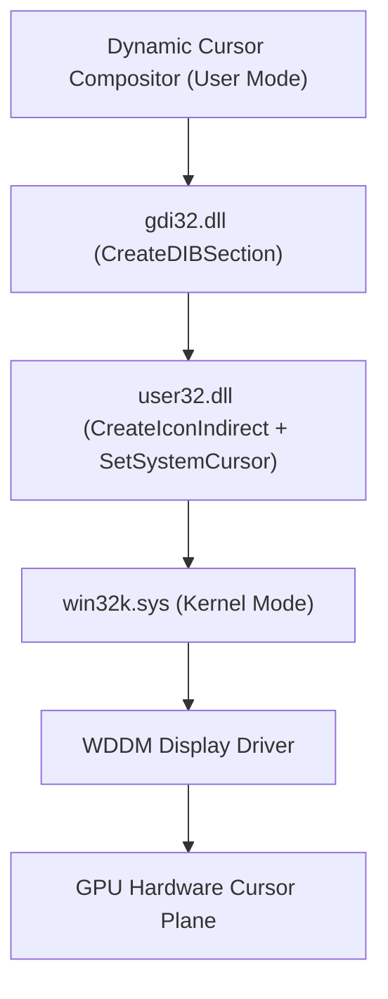
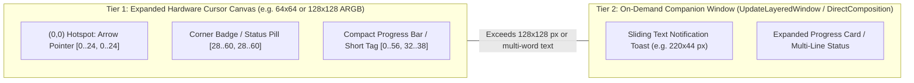

<!-- SPDX-License-Identifier: Apache-2.0 -->
<!-- Copyright (c) 2026 Amir Farhadi -->

# Win32 Subsystem Deep Dive: Cursor Compositing & Area Extension

## 1. Win32 Cursor Rendering Architecture

The Windows cursor subsystem operates across user-mode and kernel-mode layers:



Because the hardware mouse cursor is composited directly by the display adapter scanout plane, movement remains locked to monitor refresh rates (60 Hz to 240+ Hz) regardless of system load.

---

## 2. Procedural In-Memory Cursor Generation (`CreateIconIndirect`)

`SetSystemCursor` is not restricted to static `.cur` files loaded from disk via `LoadImageW`. A 32-bit pre-multiplied ARGB cursor can be constructed purely in RAM in under 45 microseconds in native C++ (and under 165 microseconds in Python ctypes):

1. Call `gdi32.CreateDIBSection` with a `BITMAPV5HEADER` or `BITMAPINFOHEADER` (`biWidth = W`, `biHeight = -H` top-down, `biBitCount = 32`, `biCompression = BI_RGB`) to obtain a raw `uint32_t*` pixel buffer in memory.
2. Composite the base arrow pixels, apply RGBA color tinting, draw a compact progress bar, or stamp a `16x16` / `24x24` badge icon into the pixel buffer using pre-multiplied ARGB mathematics:

$$\text{Pixel} = (A \ll 24) \mid \left(\left\lfloor \frac{R \cdot A}{255} \right\rfloor \ll 16\right) \mid \left(\left\lfloor \frac{G \cdot A}{255} \right\rfloor \ll 8\right) \mid \left\lfloor \frac{B \cdot A}{255} \right\rfloor$$

3. Generate a 1-bit monochrome mask via `gdi32.CreateBitmap(W, H, 1, 1, NULL)`. For 32-bit ARGB cursors, Windows derives per-pixel transparency from the alpha channel of `hbmColor`, while `hbmMask` acts as an OS format requirement.
4. Populate an `ICONINFO` structure:
   - `fIcon = FALSE` (specifies a cursor rather than an icon).
   - `xHotspot = 0`, `yHotspot = 0` (anchors the active click coordinate at the arrow tip).
   - `hbmColor = hDibSection`, `hbmMask = hMonoMask`.
5. Call `user32.CreateIconIndirect(&iconInfo)` to receive a valid `HCURSOR`.
6. Cache the master `HCURSOR` and pass `user32.CopyIcon(hMaster)` to `user32.SetSystemCursor(hCopy, OCR_NORMAL)`.

> [!IMPORTANT]
> `user32.SetSystemCursor` takes exclusive ownership of and immediately destroys the handle passed to it. Master handles cached in memory must never be passed directly. Calling `CopyIcon` immediately prior to dispatch prevents handle exhaustion and Win32 Error 1402 (`ERROR_INVALID_CURSOR_HANDLE`).

---

## 3. Extending the Cursor Area: Two-Tier Architecture

A standard Windows pointer bitmap is `32x32` pixels (`SM_CXCURSOR`), which leaves very little room for status indicators, loading bars, or text notifications. Extending the usable visual area around the cursor requires choosing the right mechanism based on the size and nature of the indicator.



### Tier 1: Expanded ARGB Hardware Cursor Canvas (Empirically Verified up to `256x256` px)
While `GetSystemMetrics(SM_CXCURSOR)` reports `32`, empirical validation in Spike 01 confirmed that Windows 11 and modern WDDM 3.x display drivers allocate exact requested dimensions (`64x64`, `128x128`, `256x256`) at 32 bpp ARGB without downscaling or cropping. Reading back pixels from `LoadCursorW(None, OCR_NORMAL)` via `GetDIBits` demonstrated full pixel fidelity at both hotspot `(0, 0)` and the extreme corner `(W - 1, H - 1)`.

When `xHotspot = 0` and `yHotspot = 0`:
- The primary arrow pointer occupies only the top-left `[0..24, 0..24]` region.
- The remaining transparent space to the right and bottom-right (`[24..63, 24..63]` on a `64x64` canvas) acts as an **attached micro-canvas inside the hardware cursor plane itself**.
- **What Tier 1 Handles Best**:
  - **Status Indicators & Corner Badges**: Microphone status dots, media playback icons (TV badge), Vim mode badges, or animated pet sprites.
  - **Compact Loading Bars**: A `56x6` pixel progress bar or circular progress ring rendered directly beneath the arrow. Updating the progress bar from `0%` to `100%` simply mutates the DIB pixel array and calls `SetSystemCursor`.
  - **Short Micro-Labels**: 3 to 6 crisp bitmap characters (such as `MUTE`, `80%`, `REC`).
- **Empirical Latency Budget (Measured across 100 iterations on 144 Hz display)**:

| Canvas Size | Creation Mean (us) | Cached Swap Mean (us) | Cached Swap p95 (us) | Frame Budget @ 144 Hz (6.94 ms) |
| :--- | :--- | :--- | :--- | :--- |
| **32x32** | 105.32 | 40.73 | 48.30 | 0.58% |
| **64x64** | 162.76 | 51.43 | 81.40 | 0.74% |
| **128x128** | 376.68 | 75.53 | 128.30 | 1.09% |
| **256x256** | 988.51 | 316.46 | 500.30 | 4.56% |

- **Key Advantage**: Zero extra windows, zero mouse movement hooks, and **0.0 ms trailing lag** at 144 Hz to 240+ Hz.
- **Architectural Decision**: Tier 1 standardizes on a `64x64` canvas. This provides ample area for arrows, corner badges, and a `56x6` progress bar while keeping swap latency under 55 microseconds (0.74% frame budget).

### Tier 2: On-Demand Extended Companion Overlay (Beyond Hardware Bounds)
When a feeder triggers a wider visual element, such as a pop-out text notification (`"Syncing Workspace [42/42]"`) or an expanded status card, it exceeds the hardware cursor canvas and requires a companion overlay window.

#### Companion Window Configuration
Create a frameless popup window with the following extended window styles:
```c
DWORD exStyle = WS_EX_LAYERED      // Allows per-pixel alpha via UpdateLayeredWindow / DirectComposition
              | WS_EX_TRANSPARENT  // 100% click-through; mouse clicks pass to underlying window
              | WS_EX_TOPMOST      // Stays above normal windows in Z-order
              | WS_EX_TOOLWINDOW   // Hidden from Taskbar and Alt+Tab
              | WS_EX_NOACTIVATE;  // Never steals keyboard focus when shown
```

#### Solving the Tracking Problem (Why We Avoid `WH_MOUSE_LL`)
Existing overlay tools (including Microsoft PowerToys Mouse Utilities) track the cursor by installing a global low-level mouse hook (`SetWindowsHookEx(WH_MOUSE_LL)`). `WH_MOUSE_LL` introduces two architectural flaws:
1. It intercepts every mouse input packet synchronously across the entire operating system before the OS moves the pointer. If the hook process stalls, the Windows mouse freezes until `LowLevelHooksTimeout` expires.
2. It runs continuously even when no notification is being shown.

Tier 2 implements two cleaner anchoring modes evaluated in Spike 02:

| Anchoring Mode | Primary Use Case | Win32 Mechanism | Measured Performance Telemetry |
| :--- | :--- | :--- | :--- |
| **Mode A: Spawn-Anchored Toast (Detach-on-Spawn)** | Text notifications & transient alerts (1 to 3 seconds) | Call `GetCursorPos(&pt)` **once** when notification arrives. Spawn toast at `(pt.x + 18, pt.y + 18)`, animate short slide-out/fade, hold stationary, and fade out. | **0 active mouse hooks.** 353.7 us median spawn latency, 0.008% to 0.048% CPU during display, 0.0% CPU when holding. Static text eliminates motion blur. |
| **Mode B: On-Demand Raw Input Follower (`RIDEV_INPUTSINK`)** | Extended attached loading bars or persistent wide HUDs | Call `RegisterRawInputDevices` (`UsagePage=0x01, Usage=0x02, dwFlags=RIDEV_INPUTSINK`) when overlay opens, move window via `SetWindowPos(..., SWP_NOACTIVATE)` on `WM_INPUT`, and unregister (`RIDEV_REMOVE`) the instant overlay hides. | **0 lingering hooks when hidden.** 55.7 us registration latency, 30.4 us unregister latency, 74.0 us median `SetWindowPos` repositioning latency, 0.0 px tracking error. |

#### Programmatic Invariant Verification (Spike 02 Results)
1. **Focus Preservation (`WS_EX_NOACTIVATE`)**: Evaluated via continuous sampling of `GetForegroundWindow()`. The foreground window handle remained strictly unchanged before, during, and after overlay activation. Active editors, terminals, and games retain uninterrupted keyboard focus.
2. **Click-Through Transparency (`WS_EX_TRANSPARENT`)**: Evaluated via `WindowFromPoint` and `WM_NCHITTEST`. OS hit-testing bypassed the overlay completely, returning the underlying desktop window handle, and `WM_NCHITTEST` returned `HTTRANSPARENT` (`-1`). All mouse clicks and scroll inputs pass through unobstructed.

---

## 4. Per-Application Cursor Override Interception (Windhawk / `SetCursor`)

Modifying `OCR_NORMAL` via `SetSystemCursor` replaces the global default arrow across Windows. However, some applications respond to `WM_SETCURSOR` by passing a custom application-owned `HCURSOR` directly to `user32!SetCursor(hCustom)`.

If universal badge or tint persistence is desired even inside applications that draw custom cursors:
- A standalone unprivileged process cannot intercept another process's internal `user32!SetCursor` call.
- A **Windhawk mod** (which injects a lightweight C++ DLL into user-mode processes and detours `user32!SetCursor` via `MinHook`) can intercept the application's custom `HCURSOR`, composite the active corner badge or tint onto it, and pass the modified handle forward.

```cpp
#include <windows.h>
#include <windhawk_api.h>

using SetCursor_t = HCURSOR(WINAPI*)(HCURSOR);
SetCursor_t pOriginal_SetCursor = nullptr;

HCURSOR WINAPI Hook_SetCursor(HCURSOR hCursor) {
    HCURSOR hOverride = GetActiveCompositedCursor(hCursor);
    if (hOverride) {
        return pOriginal_SetCursor(hOverride);
    }
    return pOriginal_SetCursor(hCursor);
}

BOOL Wh_ModInit() {
    HMODULE hUser32 = GetModuleHandleW(L"user32.dll");
    if (hUser32 == nullptr) return FALSE;

    void* target = reinterpret_cast<void*>(GetProcAddress(hUser32, "SetCursor"));
    if (target == nullptr) return FALSE;

    Wh_SetFunctionHook(target, reinterpret_cast<void*>(Hook_SetCursor),
                       reinterpret_cast<void**>(&pOriginal_SetCursor));
    return TRUE;
}
```

The mod integrates directly into the Windhawk ecosystem via Clang 20.1 targeting MinGW-w64, sharing the core compositing logic with the standalone tray daemon.
