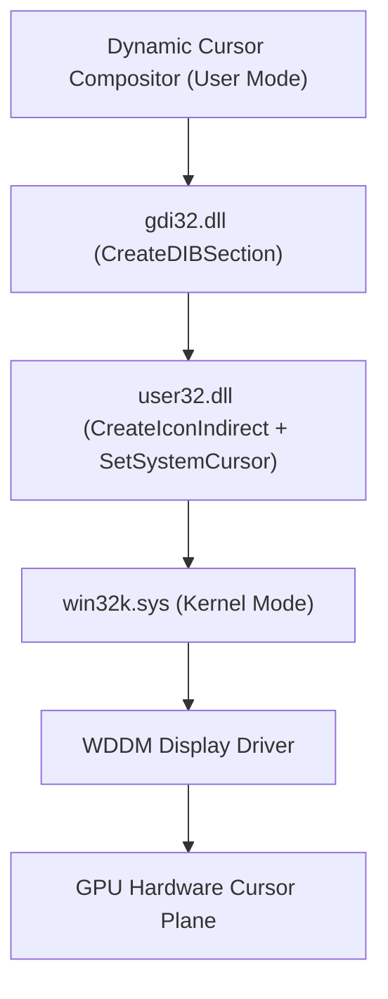
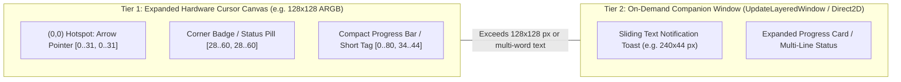

<!-- SPDX-License-Identifier: Apache-2.0 -->
<!-- Copyright (c) 2026 Amir Farhadi -->

# Win32 Subsystem Deep Dive: Cursor Compositing & Area Extension

## 1. Win32 Cursor Rendering Architecture

The Windows cursor subsystem operates across user-mode and kernel-mode layers:



Because the hardware mouse cursor is composited directly by the display adapter scanout plane, movement remains locked to monitor refresh rates (60 Hz to 240+ Hz) regardless of system load.

---

## 2. Procedural In-Memory Cursor Generation (`CreateIconIndirect`)

`SetSystemCursor` is not restricted to static `.cur` files loaded from disk via `LoadImageW`. A 32-bit pre-multiplied ARGB cursor can be constructed purely in RAM in under 20 microseconds:

1. Call `gdi32.CreateDIBSection` with a `BITMAPV5HEADER` (`biWidth = W`, `biHeight = -H` top-down, `biBitCount = 32`, `biCompression = BI_RGB`) to obtain a raw `uint32_t*` pixel buffer in memory.
2. Composite the base arrow pixels, apply RGBA color tinting, draw a compact progress bar, or stamp a `16x16` / `24x24` badge icon into the pixel buffer.
3. Populate an `ICONINFO` structure:
   - `fIcon = FALSE` (specifies a cursor rather than an icon).
   - `xHotspot = 0`, `yHotspot = 0` (anchors the active click coordinate at the arrow tip).
   - `hbmColor = hDibSection`, `hbmMask = hMonoMask`.
4. Call `user32.CreateIconIndirect(&iconInfo)` to receive a valid `HCURSOR`.
5. Cache the master `HCURSOR` and pass `user32.CopyIcon(hMaster)` to `user32.SetSystemCursor(hCopy, OCR_NORMAL)`.

---

## 3. Extending the Cursor Area: Two-Tier Architecture

A standard Windows pointer bitmap is `32x32` pixels (`SM_CXCURSOR`), which leaves very little room for status indicators, loading bars, or text notifications. Extending the usable visual area around the cursor requires choosing the right mechanism based on the size and nature of the indicator.



### Tier 1: Expanded ARGB Hardware Cursor Canvas (Up to `128x128` / `256x256` px)
While `GetSystemMetrics(SM_CXCURSOR)` reports `32`, Windows 10/11 and modern WDDM display drivers accept larger bitmaps in `CreateIconIndirect` (commonly up to `128x128` or `256x256` pixels depending on the GPU hardware cursor plane limit).

When `xHotspot = 0` and `yHotspot = 0`:
- The primary arrow pointer occupies only the top-left `[0..24, 0..24]` region.
- The remaining transparent space to the right and bottom-right (`[24..127, 24..127]`) acts as an **attached micro-canvas inside the hardware cursor plane itself**.
- **What Tier 1 Handles Best**:
  - **Status Indicators & Corner Badges**: Microphone status dots, media playback icons (TV badge), Vim mode badges, or animated pet sprites.
  - **Compact Loading Bars**: A `56x6` pixel progress bar or circular progress ring rendered directly beneath the arrow. Updating the progress bar from `0%` to `100%` simply mutates the DIB pixel array and calls `SetSystemCursor`.
  - **Short Micro-Labels**: 3 to 6 crisp bitmap characters (such as `MUTE`, `80%`, `REC`).
- **Key Advantage**: Zero extra windows, zero mouse movement hooks, and **0.0 ms trailing lag** at 240 Hz.
- **Empirical Verification Needed**: If the bitmap size exceeds the GPU driver's hardware cursor plane maximum, Windows silently falls back to software cursor blitting. Spike 1.2 in the roadmap measures the exact hardware plane size ceiling (`64x64`, `128x128`, `256x256`) on the target machine.

### Tier 2: On-Demand Extended Companion Overlay (Beyond Hardware Bounds)
When a feeder triggers a wider visual element, such as a pop-out text notification (`"Tests Passed (42/42)"`) or a wide labelled progress bar, it exceeds the hardware cursor canvas and requires a companion overlay window.

#### Companion Window Configuration
Create a frameless popup window with the following extended window styles:
```c
DWORD exStyle = WS_EX_LAYERED      // Allows per-pixel alpha via UpdateLayeredWindow / DirectComposition
              | WS_EX_TRANSPARENT  // 100% click-through; mouse clicks pass to underlying window
              | WS_EX_TOPMOST      // Stays above normal windows
              | WS_EX_TOOLWINDOW   // Hidden from Taskbar and Alt+Tab
              | WS_EX_NOACTIVATE;  // Never steals keyboard focus when shown
```

#### Solving the Tracking Problem (Why We Avoid `WH_MOUSE_LL`)
Existing overlay tools (including Microsoft PowerToys Mouse Utilities) track the cursor by installing a global low-level mouse hook (`SetWindowsHookEx(WH_MOUSE_LL)`). `WH_MOUSE_LL` has two architectural flaws:
1. It intercepts every mouse input packet synchronously across the entire operating system before the OS moves the pointer. If the hook process stalls, the Windows mouse freezes until `LowLevelHooksTimeout` expires.
2. It runs continuously even when no notification is being shown.

Instead, Tier 2 uses two cleaner anchoring modes that are active **only while the companion window is visible**:

| Anchoring Mode | Best Use Case | Win32 Mechanism | CPU & Lag Profile |
| :--- | :--- | :--- | :--- |
| **Mode A: Spawn-Anchored Toast (Detach-on-Spawn)** | Text notifications & pop-out alerts (1 to 3 seconds) | Call `GetCursorPos(&pt)` **once** when the notification arrives. Spawn the toast at `(pt.x + 18, pt.y + 18)`, animate a short slide-out, and fade out after `duration_ms`. | **Zero mouse hooks.** Also improves readability because multi-word text does not jitter while the user moves the mouse. |
| **Mode B: On-Demand Raw Input Sink (`RIDEV_INPUTSINK`)** | Extended attached loading bars or persistent wide HUDs | Call `RegisterRawInputDevices` (`UsagePage=0x01, Usage=0x02, dwFlags=RIDEV_INPUTSINK`) when the overlay opens, move the window via `SetWindowPos(..., SWP_NOACTIVATE)` on `WM_INPUT`, and unregister (`RIDEV_REMOVE`) the instant the overlay hides. | **Asynchronous (non-blocking).** Never intercepts or slows down the OS hardware cursor path; 0.0% CPU when hidden. |

---

## 4. Per-Application Cursor Override Interception (Windhawk / `SetCursor`)

Modifying `OCR_NORMAL` via `SetSystemCursor` replaces the global default arrow across Windows. However, some applications respond to `WM_SETCURSOR` by passing a custom application-owned `HCURSOR` directly to `user32!SetCursor(hCustom)`.

If universal badge or tint persistence is desired even inside applications that draw custom cursors:
- A standalone unprivileged process cannot intercept another process's internal `user32!SetCursor` call.
- A **Windhawk mod** (which injects a lightweight C++ DLL into user-mode processes and detours `user32!SetCursor` via `MinHook`) can intercept the application's custom `HCURSOR`, composite the active corner badge or tint onto it, and pass the modified handle forward.
