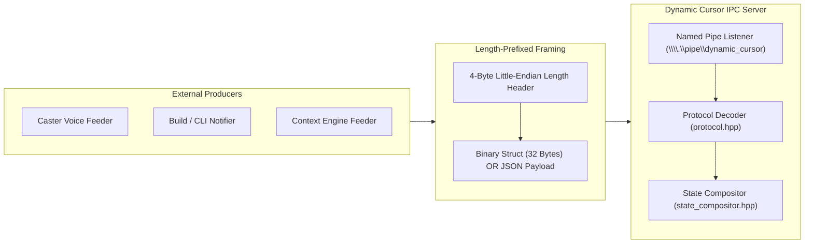
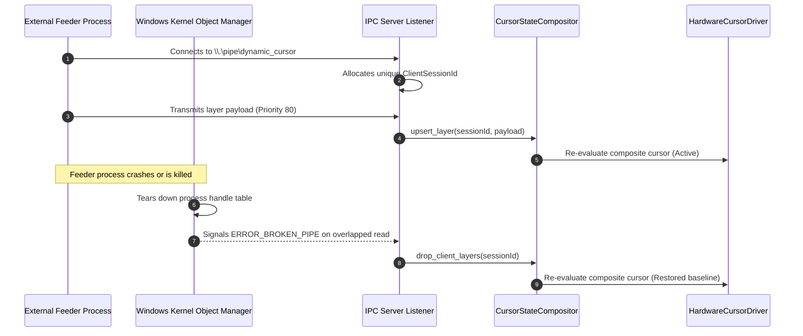

<!-- SPDX-License-Identifier: Apache-2.0 -->
<!-- Copyright (c) 2026 Amir Farhadi -->

# IPC Wire Protocol & Feeder SDK Specification

## 1. Protocol Architecture & Design Principles

The Dynamic Cursor communication subsystem decouples external context producers from the cursor rendering engine. The cursor daemon exposes a Win32 Named Pipe endpoint at `\\.\pipe\dynamic_cursor` that accepts visual layer mutations over length-prefixed framing.

The protocol provides two distinct wire formats:
1. **Length-Prefixed JSON**: A flexible format for textual, variable-length, or extended payloads including ephemeral toasts.
2. **Packed 32-Byte Binary Frame**: A fixed-size struct designed for high-frequency feeder updates (such as real-time audio meters or rapid state toggles) with zero parsing overhead.

Both wire formats share length-prefixed framing, connection lease tracking, and automatic rollback on disconnection.



---

## 2. Framing Specification

Every transmission across the Named Pipe begins with a 4-byte header specifying the byte length of the subsequent payload. This eliminates delimiter scanning, avoids buffer overruns, and enables deterministic allocation.

### Frame Layout

| Byte Offset | Field | Data Type | Encoding | Description |
| :--- | :--- | :--- | :--- | :--- |
| `0x00` | `payload_length` | `uint32_t` | Little-Endian | Byte length $N$ of the trailing payload buffer. |
| `0x04` | `payload_data` | `uint8_t[N]` | Raw Bytes | Binary packet or UTF-8 JSON text. |

The maximum allowed payload size is 16,777,216 bytes (16 MB). Payloads exceeding this limit are rejected by the server to guard against malformed packets.

### Header Encoding & Decoding

```cpp
// Decoding a 4-byte little-endian header
uint32_t decode_frame_length(const uint8_t* header_bytes) noexcept {
    return static_cast<uint32_t>(header_bytes[0])
        | (static_cast<uint32_t>(header_bytes[1]) << 8)
        | (static_cast<uint32_t>(header_bytes[2]) << 16)
        | (static_cast<uint32_t>(header_bytes[3]) << 24);
}

// Encoding a 4-byte little-endian header
void encode_frame_length(uint32_t length, uint8_t* out_header_bytes) noexcept {
    out_header_bytes[0] = static_cast<uint8_t>(length & 0xFF);
    out_header_bytes[1] = static_cast<uint8_t>((length >> 8) & 0xFF);
    out_header_bytes[2] = static_cast<uint8_t>((length >> 16) & 0xFF);
    out_header_bytes[3] = static_cast<uint8_t>((length >> 24) & 0xFF);
}
```

---

## 3. Packed Binary Wire Protocol

For high-frequency feeders, the protocol defines a packed 32-byte binary struct identified by a magic identifier. The C++ struct is packed using `#pragma pack(push, 1)` and verified at compile time with `static_assert(sizeof(BinaryPacket) == 32)`.

### Binary Packet Struct Definition

```cpp
#pragma pack(push, 1)
struct BinaryPacket {
    uint32_t magic{0x44435552}; // "DCUR" in ASCII / little-endian
    uint8_t  op{1};             // Operation: 1=Upsert, 2=Remove, 3=Clear
    uint8_t  shape{0};          // BaseShape: 0=DefaultArrow, 1=PrecisionCross, 2=ReadingMinimal
    uint16_t badge{0};          // BadgeId: 0=None, 1=MicOff, 2=MicOn, 3=TvIcon, 4=VimNormal, 5=WebGlobe, 6=CodeBrackets, 7=TerminalPrompt, 8=DocWriting
    int32_t  priority{0};       // Arbitration priority integer (signed)
    uint32_t tint_argb{0};      // 32-bit pre-multiplied ARGB color
    float    progress{-1.0f};   // Progress ratio [0.0, 1.0], or negative for inactive
    uint32_t ttl_ms{0};         // Ephemeral time-to-live in ms (0 = persistent lease)
    uint32_t layer_hash{0};     // 32-bit FNV-1a hash of the layer string identifier
    uint32_t reserved{0};       // Reserved for alignment and future expansion
};
#pragma pack(pop)
```

### Field Offset and Alignment Table

| Byte Offset | Field Name | Type | Size | Valid Values & Interpretation |
| :--- | :--- | :--- | :--- | :--- |
| `0x00` | `magic` | `uint32_t` | 4 bytes | `0x44435552` (ASCII characters `DCUR`). Rejects frame if mismatched. |
| `0x04` | `op` | `uint8_t` | 1 byte | `1` = `Upsert`, `2` = `Remove`, `3` = `Clear`. Defaults to `1`. |
| `0x05` | `shape` | `uint8_t` | 1 byte | `0` = `DefaultArrow`, `1` = `PrecisionCross`, `2` = `ReadingMinimal`. Values > 2 are ignored. |
| `0x06` | `badge` | `uint16_t` | 2 bytes | `0` = `None`, `1` = `MicOff`, `2` = `MicOn`, `3` = `TvIcon`, `4` = `VimNormal`, `5` = `WebGlobe`, `6` = `CodeBrackets`, `7` = `TerminalPrompt`, `8` = `DocWriting`. |
| `0x08` | `priority` | `int32_t` | 4 bytes | Layer arbitration priority (higher values override lower values). |
| `0x0C` | `tint_argb` | `uint32_t` | 4 bytes | 32-bit ARGB color integer. `0x00000000` indicates no tint override. |
| `0x10` | `progress` | `float` | 4 bytes | IEEE 754 single-precision float. Values $\ge 0.0$ activate loading bar. Negative values disable progress. |
| `0x14` | `ttl_ms` | `uint32_t` | 4 bytes | Ephemeral time-to-live in milliseconds. `0` maintains layer until explicit removal or pipe closure. |
| `0x18` | `layer_hash`| `uint32_t` | 4 bytes | 32-bit FNV-1a hash identifying the layer. Formats to `bin_<hash>` string key internally. |
| `0x1C` | `reserved` | `uint32_t` | 4 bytes | Must be set to `0`. Reserved for future extensions. |

---

## 4. Length-Prefixed JSON Protocol

When readability or extended attributes (such as notification text) are required, clients transmit UTF-8 JSON frames. The native core embeds an allocation-efficient JSON parser (`json_internal::MiniParser`) with zero third-party library dependencies.

### JSON Schema Specification

```json
{
  "op": "upsert",
  "layer_id": "caster_mic",
  "priority": 80,
  "base_shape": "default_arrow",
  "tint_rgba": "#44FF6680",
  "badge_id": "mic_on",
  "progress": 0.75,
  "ttl_ms": 3000,
  "toast": {
    "text": "Microphone listening",
    "duration_ms": 1500
  }
}
```

### JSON Fields & Data Types

| Key | Alternative Keys | Type | Default | Description |
| :--- | :--- | :--- | :--- | :--- |
| `op` | `action` | String / Int | `"upsert"` (`1`) | Operation verb: `"upsert"`, `"remove"`, or `"clear"`. |
| `layer_id` | `layer` | String | `"default"` | Unique string identifying the visual layer. |
| `priority` | | Integer | `0` | Arbitration priority. Higher integers win orthogonal channel conflicts. |
| `base_shape`| `shape` | String / Int | `null` | Base pointer shape: `"default_arrow"`, `"precision_cross"`, `"reading_minimal"`. |
| `tint_rgba` | `tint_argb`, `tint`| String / Int | `null` | Color tint in hex string or integer format. |
| `badge_id` | `corner_badge`, `badge` | String / Int | `null` | Bottom-right quadrant sprite: `"none"`, `"mic_off"`, `"mic_on"`, `"tv_icon"`, `"vim_normal"`, `"web_globe"`, `"code_brackets"`, `"terminal_prompt"`, `"doc_writing"`. |
| `progress` | `progress_bar`, `progress_ratio` | Float | `null` | Normalized loading ratio between `0.0` and `1.0`. |
| `ttl_ms` | | Integer | `0` | Ephemeral duration in milliseconds. Purged by timer if non-zero. |
| `toast` | | Object / String | `null` | Ephemeral micro-notification text and display duration. |

### Color String Parsing Rules

The protocol accepts both RGBA and ARGB representations:
- **6-Character Hex (`#RRGGBB` or `0xRRGGBB`)**: Interpreted as fully opaque RGB (`alpha = 0xFF`). Converted internally to `0xFFRRGGBB`.
- **8-Character Hex (`#RRGGBBAA`)**: Interpreted as CSS-style RGBA when passed to `tint_rgba` or `tint`. Alpha channel at the tail is converted to `(A << 24) | (R << 16) | (G << 8) | B`.
- **8-Character Hex (`0xAARRGGBB`)**: Interpreted as native Win32 ARGB format when passed to `tint_argb`.

---

## 5. Kernel Lease Lifecycle & Fault Tolerance

The cursor daemon does not require heartbeats or polling keep-alives. Instead, it relies on the Windows kernel Object Manager handle table.



1. **Session Binding**: Upon connection, the server assigns a monotonic `uint64_t client_session_id` to the pipe instance. Every layer upserted over that connection is tagged with this session identifier.
2. **Crash Interception**: When a feeder crashes, terminates abnormally, or is killed via `TerminateProcess`, the operating system closes all open handles in the process handle table.
3. **Rollback Latency**: The broken handle delivers `ERROR_BROKEN_PIPE` to the server's overlapped I/O routine. The server immediately calls `CursorStateCompositor::drop_client_layers(session_id)` and updates the hardware cursor. Measured latency on Windows 11 is 940 microseconds (under 1 millisecond).

---

## 6. Python Feeder SDK Reference

The repository provides an idiomatic, dependency-free Python feeder SDK in `src/dynamic_cursor/client.py`. It uses `ctypes` to invoke Win32 Named Pipe system APIs directly.

### Class: `DynamicCursorClient`

```python
from dynamic_cursor.client import DynamicCursorClient

with DynamicCursorClient() as client:
    client.set_layer(
        layer_id="caster_mic",
        priority=80,
        base_shape="default_arrow",
        tint_rgba="#44FF66",
        badge_id="mic_on",
    )
```

#### Constructor Parameters

- `pipe_name` (`str`, default: `r"\\.\pipe\dynamic_cursor"`): Path of the Win32 Named Pipe.
- `timeout_ms` (`int`, default: `5000`): Maximum time to wait for pipe availability before raising `TimeoutError`.
- `auto_connect` (`bool`, default: `True`): Automatically opens the pipe handle during initialization.

#### Public Methods

##### `set_layer`
Asserts or updates a visual cursor state layer.
```python
def set_layer(
    self,
    layer_id: str,
    priority: int,
    base_shape: Optional[str] = None,
    tint_rgba: Optional[str] = None,
    badge_id: Optional[str] = None,
    progress: Optional[float] = None,
    ttl_ms: int = 0,
    use_binary: bool = False,
) -> None
```
- When `use_binary=True`, attributes are packed into a 32-byte `BinaryPacket` struct.
- When `use_binary=False`, attributes are transmitted as a length-prefixed JSON frame.

##### `clear_layer`
Removes an asserted layer by identifier.
```python
def clear_layer(self, layer_id: str) -> None
```

##### `clear_all`
Purges all layers asserted by this client connection.
```python
def clear_all(self) -> None
```

##### `show_toast`
Dispatches an ephemeral micro-notification to the companion overlay window.
```python
def show_toast(self, text: str, duration_ms: int = 1500) -> None
```

##### `send_binary`
Directly transmits a raw 32-byte binary frame.
```python
def send_binary(
    self,
    op: int,
    priority: int,
    shape: int = 0,
    badge: int = 0,
    tint_argb: int = 0,
    progress: float = -1.0,
    ttl_ms: int = 0,
    layer_hash: int = 0,
) -> None
```

---

## 7. Command Line Interface (CLI) Reference

The Python feeder module includes a built-in CLI utility executable via `python -m dynamic_cursor.client`.

### Global CLI Options

```pwsh
python -m dynamic_cursor.client [--pipe PIPE_PATH] <command> [arguments]
```

- `--pipe`: Custom named pipe path (default: `\\.\pipe\dynamic_cursor`).

### Subcommand: `set`

Asserts or updates a visual state layer.

```pwsh
python -m dynamic_cursor.client set [options]
```

| Argument | Type | Default | Description |
| :--- | :--- | :--- | :--- |
| `--layer` | String | `"default"` | Unique layer identifier. |
| `--priority` | Integer | `50` | Priority integer for arbitration. |
| `--shape` | Choice | `None` | `default_arrow`, `precision_cross`, `reading_minimal`. |
| `--tint` | String | `None` | Hex color string (e.g., `#FF5555` or `#44FF6680`). |
| `--badge` | Choice | `None` | `none`, `mic_off`, `mic_on`, `tv_icon`, `vim_normal`, `web_globe`, `code_brackets`, `terminal_prompt`, `doc_writing`. |
| `--progress` | Float | `None` | Progress ratio from `0.0` to `1.0`. |
| `--ttl` | Integer | `0` | Time-to-live in milliseconds. |
| `--binary` | Flag | `False` | Transmit using 32-byte packed binary format. |
| `--hold` | Float | `0.0` | Hold pipe lease open for specified seconds before exit. |

#### CLI Usage Examples

```pwsh
# Set red microphone-sleeping tint at priority 80 and hold for 10 seconds
python -m dynamic_cursor.client set --layer mic --priority 80 --tint "#FF5555" --hold 10

# Set precision cross cursor with binary wire format
python -m dynamic_cursor.client set --layer sniper --priority 90 --shape precision_cross --binary

# Set ephemeral progress bar with 4-second TTL
python -m dynamic_cursor.client set --layer build --priority 60 --progress 0.45 --ttl 4000
```

### Subcommand: `clear`

Removes a specific visual layer.

```pwsh
python -m dynamic_cursor.client clear --layer mic
```

### Subcommand: `clear-all`

Purges all active layers associated with the client connection.

```pwsh
python -m dynamic_cursor.client clear-all
```

### Subcommand: `toast`

Displays an ephemeral text notification in the companion overlay.

```pwsh
python -m dynamic_cursor.client toast "Build completed: 42 targets compiled" --duration 2500
```

