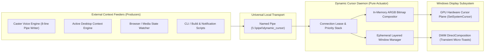

<!-- SPDX-License-Identifier: Apache-2.0 -->
<!-- Copyright (c) 2026 Amir Farhadi -->

# Exploratory Vision: Universal Cursor Compositor & Feeder Ecosystem

## 1. Purpose of This Document

This document captures architectural explorations for evolving `dynamic-cursor` from a Python-based accessibility library into a universal, ultra-minimal native Windows cursor compositor. Existing baseline documents in [`docs/CONTEXT.md`](../CONTEXT.md) and [`docs/architecture/01_system_architecture.md`](../architecture/01_system_architecture.md) remain unchanged while these concepts are evaluated.

---

## 2. Core Shift: Pure Cursor Sink vs. External Feeders

The initial architecture bundled workspace observation (`SetWinEventHook`, Caster callbacks) directly into Layer 4 of `dynamic-cursor`. A cleaner systemic boundary removes all workspace awareness from `dynamic-cursor` and restricts its responsibility to real-time visual state arbitration and cursor composition.

### Why a Pure Sink Still Needs a State Engine
Existing utilities such as `WinCursorChanger` fail in multi-tool environments because they expose only a stateless cursor replacement call. When two external tools attempt to modify the cursor concurrently, the last writer overwrites the previous state and leaves no recovery path when a tool exits.

By retaining the priority stack and handle cache inside the minimal cursor sink:
1. **Multi-Property Composition**: One feeder can assert a base color tint (such as Caster setting microphone status to red at priority 80) while a second feeder asserts a corner badge (such as the Active Desktop Context Engine attaching a media icon at priority 20). The compositor merges non-conflicting visual channels into a single hardware cursor bitmap.
2. **Kernel-Managed Process Leases**: When an external feeder connects to `\\.\pipe\dynamic_cursor`, the Windows kernel tracks the file handle lifecycle. If the feeder process crashes or terminates without sending a clear command, the kernel immediately signals `ERROR_BROKEN_PIPE` to the cursor daemon, which purges all states owned by that session and re-evaluates the stack.

---

## 3. Reimagining Cursor Capabilities: Hardware Plane vs. Ephemeral Overlay

Windows provides two distinct rendering paths near the mouse pointer. Assigning visual features to the appropriate rendering path preserves zero-lag pointer movement while enabling rich visual extensions.

### Path A: In-Memory Hardware Cursor Compositing (`CreateIconIndirect`)
`user32.SetSystemCursor` is not limited to static `.cur` files on disk. Using `gdi32.CreateDIBSection` and `user32.CreateIconIndirect`, the daemon can allocate a 32-bit ARGB pixel buffer (`64x64` or `128x128` pixels) in memory, composite multiple visual layers in microseconds, and hand the resulting `HCURSOR` to the display driver hardware cursor plane.

Features that execute inside the Hardware Cursor Plane with **0.0 ms motion lag** and **0.0% mouse-movement CPU overhead**:
- **Dynamic Shape & Scale Replacement**: Swapping the primary pointer silhouette based on reading mode, media playback, or precision tasks.
- **Procedural Color Tinting**: Recoloring the active cursor bitmap in memory using RGBA/HSV transforms without pre-generating dozens of `.cur` files on disk.
- **Corner Sub-Badges (`16x16` or `24x24` quadrant overlays)**: Stamping a compact TV icon during YouTube playback, a microphone indicator dot, or a keyboard layer glyph directly into the bottom-right quadrant of the hardware cursor bitmap.
- **Hardware-Locked Desktop Pet / Animated Sprites**: Stepping through compact sprite frames inside the hardware cursor slot so the companion graphic travels with the hardware pointer at 240+ Hz without installing a `WH_MOUSE_LL` hook.

### Path B: Ephemeral DWM Layered Companion (`UpdateLayeredWindow`)
Hardware cursor bitmaps are bounded by GPU cursor plane dimensions (`128x128` or `256x256` pixels). When an external feeder requests a wider visual element, such as a micro-notification sliding out from the bottom-right of the pointer, the daemon spawns a click-through layered window (`WS_EX_LAYERED | WS_EX_TRANSPARENT | WS_EX_TOOLWINDOW | WS_EX_NOACTIVATE`).

To avoid the continuous CPU and trailing overhead seen in Microsoft PowerToys Mouse Utilities:
- The layered window is created or shown **only** for the duration of the transient notification (e.g., 1500 ms).
- While no notification toast is active, the layered window and any mouse-tracking hooks remain completely disabled.

---

## 4. Implementation Language Analysis: C vs. C++ vs. Python

Decoupling `dynamic-cursor` from Caster removes the requirement to run inside a Python interpreter. For a Windows-only system component focused on minimal footprint and real-time bitmap manipulation, native compilation offers clear advantages over Python.

| Evaluation Criterion | Python 3.10 (`ctypes`) | Pure C (C17 / Win32 API) | Modern C++ (C++20 / Win32 API) |
| :--- | :--- | :--- | :--- |
| **Memory Working Set** | 18 MB to 30 MB | 0.8 MB to 1.5 MB | 1.0 MB to 1.8 MB |
| **Standalone Binary Size** | ~10 MB (bundled runtime) | ~35 KB to 60 KB | ~50 KB to 90 KB |
| **In-Memory Pixel Blending** | Requires `Pillow` or `numpy` | Raw pointer loop / SIMD | Raw pointer loop / Direct2D COM |
| **Win32 COM / Direct2D Ergonomics** | Verbose `ctypes` vtables | Manual `lpVtbl` struct dereferencing | Native COM smart pointers (`wil` / `ComPtr`) |
| **RAII Handle Safety (`HCURSOR`, `HBITMAP`)** | Manual `try/finally` | Manual `goto cleanup` | Deterministic destructors |
| **Windhawk Mod Compatibility** | Unsupported | Supported (compiled as C++) | First-class (Windhawk mods are C++20) |

### Recommendation: C++20 with a C-Style Minimal Footprint
Writing the core engine in **C++20** (avoiding heavy STL abstractions or exceptions, using C++ primarily for RAII handle wrappers, `constexpr`, and clean Direct2D/GDI+ COM calls) provides the exact same binary size (~50 KB) and speed as pure C, while remaining 100% compatible with Windhawk's Clang compiler and preventing `HCURSOR` / `HBITMAP` leaks through deterministic scope destructors.

---

## 5. Distribution & Hooking Strategy: System Tray Daemon vs. Windhawk Mod

Windhawk operates by injecting a compiled C++ DLL into target Windows processes and detouring Win32 API functions via `MinHook`. Evaluating a standalone System Tray daemon alongside a Windhawk mod highlights two complementary capabilities.

### 1. Standalone System Tray Daemon (`dynamic-cursor.exe`)
- **Mechanism**: Unprivileged user-mode process running a standard Win32 message loop (`GetMessageW`), hosting a `Shell_NotifyIconW` tray icon, and listening on `\\.\pipe\dynamic_cursor`.
- **Advantages**:
  - Requires zero DLL injection and zero administrator privileges.
  - Triggers no false positives from enterprise EDR sensors or kernel-level game anti-cheat engines (Vanguard, EasyAntiCheat, BattlEye).
  - Runs on any clean Windows 10/11 installation as a single portable executable.

### 2. Windhawk Mod (`dynamic-cursor.wh.cpp`)
- **Mechanism**: C++ source file compiled locally by Windhawk's Clang toolchain and injected into `explorer.exe` or application processes.
- **Advantages**:
  - **Built-in Distribution & Settings UI**: Windhawk provides an integrated mod browser, one-click installation, and automatic YAML-to-GUI configuration settings for end users.
  - **Per-Application `user32!SetCursor` Interception**: Standard `SetSystemCursor` modifies global `OCR_*` slots. However, when an application (such as a custom creative suite or game) handles `WM_SETCURSOR` and passes its own custom `HCURSOR` to `user32!SetCursor`, it bypasses `OCR_NORMAL`. A Windhawk mod can detour `user32!SetCursor` inside the target application and apply dynamic tinting or corner badges even to application-specific custom cursors.

### Dual-Target Architecture
Because Windhawk mods are written in C++, the core compositor and Named Pipe state server can live in a shared header-only or single-translation-unit C++ core:
1. **Standalone Build**: Compiles into `dynamic-cursor.exe` with a lightweight system tray menu for users who want a standalone portable tool.
2. **Windhawk Build**: Wraps the core in Windhawk's `@WindhawkMod` metadata header so users on the Windhawk platform can install and configure it directly from the Windhawk catalog.

---

## 6. Visual Fidelity & Proximity Horizons (Inspirations from TinyHand)

Analysis of the open-source macOS pointer actuator [`nilbuild/tinyhand`](https://github.com/nilbuild/tinyhand) surfaced several techniques for visual ergonomics and rendering precision. Rather than rushing experimental mechanics into production, these findings are cataloged here as reference models for future visual refinement.

### 1. Tight Proximity Anchoring (Eliminating Canvas Dead Space)
- **Current Observation**: In `BitmapCompositor::compose`, the engine allocates a `64x64` ARGB canvas. The base arrow pointer occupies `16x19` pixels rooted at `(0, 0)`, while status badges are positioned at `(width - 20, height - 20)` (`44, 44`). This creates a diagonal dead space of over 30 transparent pixels, causing attached indicators to feel disconnected from the cursor.
- **Architectural Solution**: Calculate badge placement relative to the active pointer silhouette's bounding box rather than the canvas boundaries. For a standard arrow, placing the badge at `(14, 12)` keeps it tucked immediately alongside the pointer stem. This creates a compact, unified visual silhouette while remaining entirely within the hardware cursor plane.

### 2. Direct-to-Bitmap Micro Text Strips (Zero-Overlay Path)
- **Current Observation**: Any text display currently routes through `CompanionOverlay::show_toast`, which spawns a dedicated Win32 layered window clamped to a 200-pixel minimum width and placed at a `+18px` offset.
- **Architectural Solution**: For short 2-to-4 character status indicators (such as `VIM`, `REC`, `NUM`, `INS`, or `OFF`), investigate rasterizing tiny monochrome or tinted text strips directly into the `64x64` hardware cursor bitmap using a compact 3x5 or 4x6 pixel font.
- **Trade-Off**: Text rendered inside the hardware cursor plane tracks mouse movement at display refresh rates (144 Hz to 240 Hz) with zero motion lag, zero window-management overhead, and zero companion window synchronization.

### 3. Anti-Aliased Procedural Rasterization
- **Current Observation**: `bitmap_compositor.hpp` currently renders the default pointer via a 1-bit ASCII bitmap mask (`kArrowMask`), producing stair-stepped edges on high-DPI displays.
- **Architectural Solution**: Evaluate signed-distance-field (SDF) rasterization or Direct2D software rendering into the 32-bit pre-multiplied DIB section (`CreateDIBSection`). Computing sub-pixel edge coverage ensures smooth contours and clean scaling across high-DPI monitors.

### 4. Kinetic Click Feedback & Tactile Settling
- **Inspiration**: `tinyhand` applies an exponential decay compression (`pressAmount += (0 - pressAmount) * 0.18`) on mouse clicks, briefly compressing the pointer scale by 6% and pulling drop shadows tighter to simulate a tactile surface press.
- **Exploration**: In Windows, a feeder or raw input listener could trigger a subtle 1-pixel inward depression offset or a momentary outline brightness flare on left mouse clicks, providing visual confirmation of click registration.

### 5. Ephemeral Presentation Ink Layer
- **Inspiration**: `tinyhand` includes an on-demand drawing layer using midpoint quadratic Bezier curves (`path.addQuadCurve`) that automatically fades out after 0.6 seconds.
- **Exploration**: The existing Mode B companion overlay (`CompanionOverlay`) could be extended to support temporary trailing annotations for screen recordings and presentations, clearing automatically without manual cleanup.

