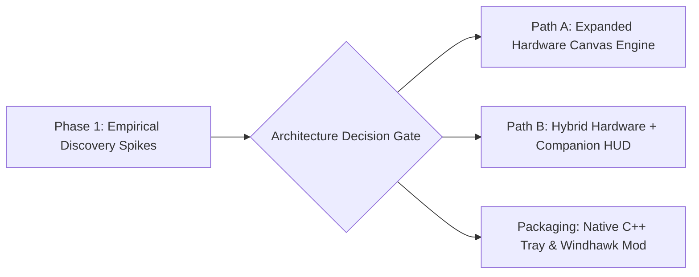

<!-- SPDX-License-Identifier: Apache-2.0 -->
<!-- Copyright (c) 2026 Amir Farhadi -->

# Living Implementation Roadmap

## 1. Roadmap Philosophy: Discovery-Driven Horizon

This roadmap focuses intentionally on **near-term empirical validation spikes** rather than rigid long-range milestones. Because low-level Win32/WDDM behaviors (such as the maximum hardware cursor bitmap size before software fallback and the ergonomics of on-demand companion windows) directly affect the core engine design, findings from Phase 1 will determine the exact structure of subsequent phases.

---

## 2. Phase 1: Immediate Empirical Discovery Spikes (Up Next)

**Goal:** Answer the critical low-level Win32 questions using small, isolated test spikes before committing to the production C/C++ daemon structure.

- [ ] **Spike 1.1: Procedural In-Memory Cursor Compositing (`CreateDIBSection` + `CreateIconIndirect`)**
  - **Question to Answer**: Can we construct a 32-bit pre-multiplied ARGB cursor buffer in memory, dynamically tint the arrow, stamp a corner badge, and swap it via `SetSystemCursor` in under 0.2 ms without touching `.cur` files on disk?
  - **Deliverable**: Minimal script verifying procedural RGBA generation, `CopyIcon` handle safety, and `SPI_SETCURSORS` restoration.

- [ ] **Spike 1.2: Hardware Cursor Canvas Size Ceiling (`64x64`, `128x128`, `256x256`)**
  - **Question to Answer**: How large can the bitmap passed to `CreateIconIndirect` be on Windows 11 before the GPU display driver either scales it down to `32x32` or falls back to a lagging software cursor?
  - **Deliverable**: Empirical test rendering a normal-sized pointer at hotspot `(0,0)` inside a `64x64`, `128x128`, and `256x256` transparent canvas, placing a status badge, compact loading bar (`56x6` px), and 5-character bitmap label in the bottom-right quadrant.

- [ ] **Spike 1.3: Extended Cursor Area Mechanisms (Tier 2 Companion Window)**
  - **Question to Answer**: For visual elements that exceed hardware cursor bounds (such as sliding text notifications or wide progress bars), how do the two candidate companion window modes compare in readability and feel?
    1. **Mode A (Spawn-Anchored Toast)**: Click-through `UpdateLayeredWindow` popup spawned once at `GetCursorPos()` (`pt.x + 18, pt.y + 18`) that slides out and stays anchored in place for 1.5s while the cursor keeps moving freely.
    2. **Mode B (On-Demand Raw Input Follower)**: Click-through companion window that registers `RegisterRawInputDevices` (`RIDEV_INPUTSINK`) only while visible so an extended loading bar follows the pointer without using `WH_MOUSE_LL`.
  - **Deliverable**: Side-by-side comparison of Mode A and Mode B for text notifications, loading bars, and status cards.

- [ ] **Spike 1.4: Named Pipe Sink & Kernel Lease Auto-Rollback**
  - **Question to Answer**: When an external feeder connects to `\\.\pipe\dynamic_cursor`, pushes a state layer, and is forcibly terminated, how fast and reliably does the pipe server detect disconnection and roll back the cursor state?
  - **Deliverable**: Minimal IPC server + dummy feeder test verifying automatic state cleanup on feeder crash.

---

## 3. Near-Term Tasks (Shaped by Phase 1 Discoveries)

Once Phase 1 spikes establish the exact boundary between Tier 1 (Hardware Cursor Canvas) and Tier 2 (Companion Overlay):

- [ ] **Task 2.1: Define the Feeder Wire Protocol**: Lock in the minimal JSON or binary payload schema for `base_shape`, `tint_rgba`, `corner_badge`, `progress_bar`, `toast`, and `priority`.
- [ ] **Task 2.2: Core C++20 Compositor & State Engine**: Implement the lightweight native C++ state stack, handle cache, and ARGB pixel blender.
- [ ] **Task 2.3: Minimal External Feeder Bridges**:
  - Write the ~10-line Caster `EngineModesManager.add_mic_listener` pipe writer snippet.
  - Define the hook point for the Active Desktop Context Engine to feed application/media context into the pipe.

---

## 4. Exploratory Parking Lot (Questions & Ideas to Investigate Later)

These items are intentionally kept in the exploration queue so we do not over-engineer early phases:

- **Windhawk Mod Packaging & `user32!SetCursor` Hooking**:
  - Explore wrapping the C++ core as a Windhawk mod (`dynamic-cursor.wh.cpp`) both to reach the Windhawk community and to test intercepting `user32!SetCursor` inside apps that override `OCR_NORMAL` with custom cursors.
- **Hardware-Locked Desktop Pet / Animated Sprite Frames**:
  - Explore stepping through multi-frame sprite sheets (or `.ani` memory streams via `CreateIconFromResourceEx`) inside the bottom-right quadrant of the hardware cursor canvas so a tiny companion animation reacts to system events.
- **Contextual Cursor Morphing**:
  - Explore subtle cursor transformations fed by external context (such as a minimal reading cursor in documentation/PDF views, a media badge during YouTube playback, or a progress ring during background compilation).
- **Per-Monitor DPI Scaling Awareness**:
  - Investigate how `CreateIconIndirect` bitmaps behave when dragging across monitors with different DPI scaling factors (e.g., 100% vs 150%) and whether `WM_DPICHANGED` adjustments are needed.
