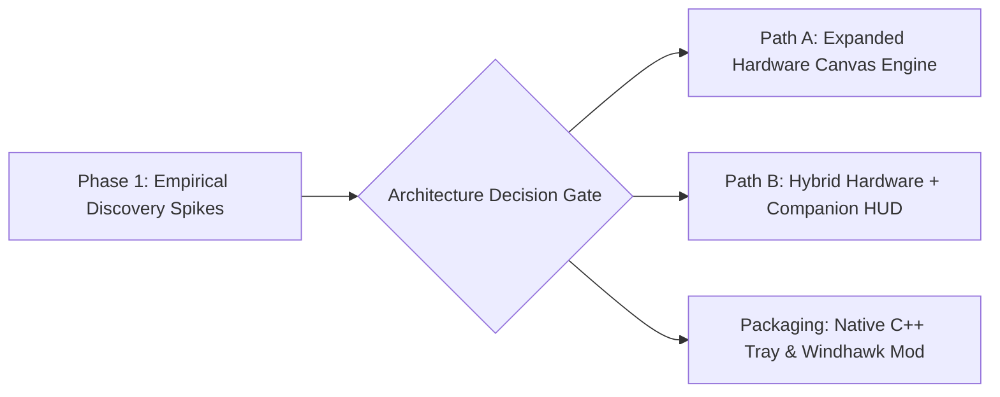

<!-- SPDX-License-Identifier: Apache-2.0 -->
<!-- Copyright (c) 2026 Amir Farhadi -->

# Living Implementation Roadmap

## 1. Roadmap Philosophy: Discovery-Driven Horizon

This roadmap focuses intentionally on **near-term empirical validation spikes** rather than rigid long-range milestones. Because low-level Win32/WDDM behaviors (such as the maximum hardware cursor bitmap size before software fallback and the ergonomics of on-demand companion windows) directly affect the core engine design, findings from Phase 1 will determine the exact structure of subsequent phases.

---

## 2. Phase 1: Completed Empirical Discovery Spikes

All Phase 1 discovery spikes have been empirically executed and validated on native Windows 11:

- [x] **Spike 1.1: Procedural In-Memory Cursor Compositing (`CreateDIBSection` + `CreateIconIndirect`)**
  - **Empirical Metric**: In-memory ARGB creation executed in 105.3 us (`32x32`) and 162.8 us (`64x64`); cached `CopyIcon` + `SetSystemCursor` swap latency measured at 40.7 us (`32x32`) and 51.4 us (`64x64`).
  - **Key Finding**: Pre-multiplied ARGB is strictly required by the WDDM scanout plane to avoid black border fringing. A 15-frame progress bar animation completed at 51.9 us per frame swap with zero hitching. The handle duplication protocol was confirmed; passing master cached handles directly causes Win32 Error 1402 because `SetSystemCursor` takes ownership and destroys the input handle.
  - **Report**: [docs/spikes/report_01_hardware_canvas.md](../spikes/report_01_hardware_canvas.md).

- [x] **Spike 1.2: Hardware Cursor Canvas Size Ceiling (`64x64`, `128x128`, `256x256`)**
  - **Empirical Metric**: Windows 11 and WDDM 3.x allocate exact requested dimensions at 32 bpp ARGB without downscaling or cropping. Reading back pixels via `GetDIBits` from `LoadCursorW(None, OCR_NORMAL)` verified pixel fidelity at both hotspot `(0, 0)` and the extreme corner `(W - 1, H - 1)`.
  - **Architectural Decision**: Tier 1 standardizes on a `64x64` canvas (with `128x128` available for wide badges). A `64x64` canvas provides ample room for the primary arrow pointer, a `56x6` progress bar beneath the arrow, and a corner badge while consuming only 0.74% of the frame interval on a 144 Hz display panel (6.94 ms frame period).
  - **Report**: [docs/spikes/report_01_hardware_canvas.md](../spikes/report_01_hardware_canvas.md).

- [x] **Spike 1.3: Extended Cursor Area Mechanisms (Tier 2 Companion Window)**
  - **Empirical Metric**: Mode A (Spawn-Anchored Toast) achieved 353.7 us median spawn latency, 0.008% to 0.048% CPU during display, 0.0% CPU during hold, and zero active mouse hooks. Mode B (On-Demand Raw Input Follower) achieved 55.7 us registration latency, 30.4 us unregister latency, 74.0 us median `SetWindowPos` repositioning latency, and zero lingering hooks on teardown.
  - **Invariant Verification**: Programmatic testing confirmed that `GetForegroundWindow()` remained strictly unchanged across overlay lifecycles (`WS_EX_NOACTIVATE` integrity), and `WM_NCHITTEST` returned `HTTRANSPARENT` (`-1`) while `WindowFromPoint` returned the underlying window (`WS_EX_TRANSPARENT` integrity).
  - **Architectural Decision**: Adopt Mode A as the default presentation for text-heavy notifications and feeder alerts to eliminate text jitter during mouse motion. Reserve Mode B strictly for explicit requests for attached continuous HUDs.
  - **Report**: [docs/spikes/report_02_companion_overlay.md](../spikes/report_02_companion_overlay.md).

- [x] **Spike 1.4: Named Pipe Sink & Kernel Lease Auto-Rollback**
  - **Empirical Metric**: Length-prefixed Win32 Named Pipe server achieved 21,767.8 messages per second in interpreted Python ctypes, with 25.45 us one-way arbitration latency (mean) and 45.62 us full round-trip latency.
  - **Key Finding**: Merged orthogonal channels from Feeder A (Priority 80, red tint) and Feeder B (Priority 20, TV badge) cleanly into a single composite state. Forcible termination of Feeder A via `TerminateProcess` triggered kernel handle teardown, delivering `ERROR_BROKEN_PIPE` to the server in 940.10 us (0.94 ms) and automatically rolling back Feeder A's layer while preserving Feeder B's badge.
  - **Report**: [docs/spikes/report_03_named_pipe_leases.md](../spikes/report_03_named_pipe_leases.md).

- [x] **Spike 1.5: Native C++20 Toolchain & Windhawk Architecture**
  - **Empirical Metric**: Host reconnaissance identified MSVC 19.50 (`cl.exe`), Windows 11 SDK `10.0.26100.0`, CMake 3.31, Ninja 1.12, and Windhawk v1.5 with Clang 20.1. Minimal C++20 Win32 cursor generation benchmark compiled to 262 KB with MSVC, consuming 1.33 MB private working set with 42.56 us handle cycle latency (~23,000 cycles/sec).
  - **Architectural Decision**: Adopt a shared C++20 core engine supporting dual distribution targets: a standalone system tray daemon (`dynamic-cursor-tray.exe`, ~256 KB) and a Windhawk mod (`dynamic-cursor.wh.cpp`) intercepting `SetCursor` in `user32.dll` via `Wh_SetFunctionHook` for apps that override `OCR_NORMAL`.
  - **Report**: [docs/spikes/report_04_native_toolchain.md](../spikes/report_04_native_toolchain.md).

---

## 3. Phase 2 Implementation Tasks (Native C++20 Architecture)

With low-level Win32 boundaries empirically established, Phase 2 implements the production native engine:

- [ ] **Task 2.1: Wire Protocol & Framing Specification**
  - Finalize length-prefixed protocol: 4-byte unsigned 32-bit little-endian length prefix + UTF-8 payload.
  - Implement a compact 32-byte binary struct option for high-frequency channels (`base_shape`, `tint_rgba`, `corner_badge`, `progress_bar`), preserving JSON formatting for extended toast payloads.
- [ ] **Task 2.2: Shared Native C++20 Core Engine**
  - Scaffold `src/core/` using CMake 3.31 and Ninja with MSVC 19.50 (`/std:c++20 /O2 /EHsc /W4 /permissive- /utf-8`).
  - Implement Win32 I/O Completion Port (IOCP) Named Pipe server at `\\.\pipe\dynamic_cursor` with security descriptor restricting access to the active user session.
  - Implement Multi-Channel Priority Compositor with atomic state re-evaluation on client handle teardown (`ERROR_BROKEN_PIPE`).
  - Implement in-memory 32-bit pre-multiplied ARGB DIBSection compositor with RAII handle wrappers and an LRU cache of master `HCURSOR` handles keyed by composite state hash.
- [ ] **Task 2.3: Dual-Tier Rendering Backend**
  - Tier 1: Hardware cursor plane driver managing `64x64` canvases via `CopyIcon` + `SetSystemCursor(OCR_NORMAL)`.
  - Tier 2: Companion overlay driver hosting Mode A (Spawn-Anchored Toast, 0.35 ms spawn, 0 hooks) and on-demand Mode B (Raw Input Follower via `RIDEV_INPUTSINK` / `RIDEV_REMOVE`).
- [ ] **Task 2.4: Standalone System Tray Daemon (`dynamic-cursor-tray.exe`)**
  - Implement lightweight WinMain message pump and system tray icon (`Shell_NotifyIcon`) supporting pause/resume toggling, diagnostic inspection, and clean exit.
  - Register console control handlers (`SetConsoleCtrlHandler`) and exit hooks calling `SPI_SETCURSORS` to guarantee cursor scheme restoration.
- [ ] **Task 2.5: Windhawk Mod Package (`dynamic-cursor.wh.cpp`)**
  - Package shared core as a Windhawk mod compiling under bundled Clang 20.1 with `windhawk_api.h`.
  - Implement `Wh_SetFunctionHook` for `user32!SetCursor` to intercept application-specific cursors that override global system slots during `WM_SETCURSOR`.
- [ ] **Task 2.6: Production Feeder Bridges**
  - Author the lightweight Caster voice hook integration (`EngineModesManager.add_mic_listener` pipe writer).
  - Define integration endpoint for the Active Desktop Context Engine.

---

## 4. Exploratory Parking Lot (Questions & Ideas to Investigate Later)

These items are intentionally kept in the exploration queue so we do not over-engineer early phases:

- **Windhawk Mod Packaging & `user32!SetCursor` Hooking**:
  - Explore wrapping the C++ core as a Windhawk mod (`dynamic-cursor.wh.cpp`) both to reach the Windhawk community and to test intercepting `user32!SetCursor` inside apps that override `OCR_NORMAL` with custom cursors.
- **Hardware-Locked Desktop Pet / Animated Sprite Frames**:
  - Explore stepping through multi-frame sprite sheets (or `.ani` memory streams via `CreateIconFromResourceEx`) inside the bottom-right quadrant of the hardware cursor canvas so a tiny companion animation reacts to system events.
- **Contextual Cursor Morphing**:
  - Explore subtle cursor transformations fed by external context (such as a minimal reading cursor in documentation/PDF views, a media badge during YouTube playback, or a progress ring during background compilation).
- **Per-Monitor DPI Scaling Awareness**:
  - Investigate how `CreateIconIndirect` bitmaps behave when dragging across monitors with different DPI scaling factors (e.g., 100% vs 150%) and whether `WM_DPICHANGED` adjustments are needed.
