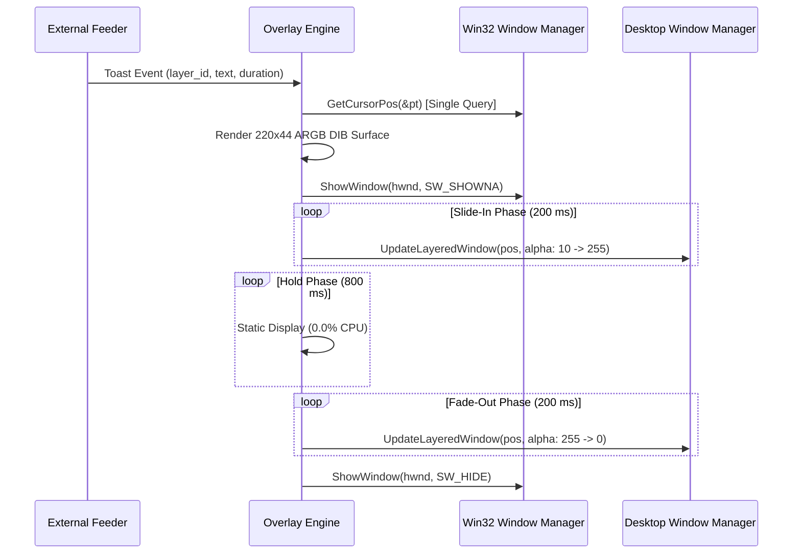

<!-- SPDX-License-Identifier: Apache-2.0 -->
<!-- Copyright (c) 2026 Amir Farhadi -->

# Spike 02 Report: Win32 Companion Overlay Architecture, Ephemeral Anchoring, and Click-Through Invariants

## 1. Executive Summary

This investigation evaluates the architecture, rendering performance, and lifecycle invariants of the Tier 2 Extended Companion Overlay for `dynamic-cursor`. When visual notifications or progress indicators exceed the hardware cursor canvas limit (such as multi-word strings or expanded status cards), a companion popup window provides visual extension near the cursor without modifying system cursor slots or inducing display stutter.

The empirical benchmark script [spikes/spike_02_companion_overlay.py](../../spikes/spike_02_companion_overlay.py) validates a 64-bit safe Win32 layered window implementation across two operating modes: Mode A (Spawn-Anchored Toast) and Mode B (On-Demand Raw Input Follower). The benchmark tests pre-multiplied 32-bit ARGB surface composition via `UpdateLayeredWindow`, records microsecond-level spawn and repositioning latencies, monitors process CPU utilization, and programmatically verifies keyboard focus preservation and click-through transparency.

The empirical data demonstrates that Mode A achieves sub-millisecond spawn latency (median 353.7 us) with near-zero CPU consumption (mean 0.008% to 0.048%) and zero installed mouse hooks. Mode B delivers rapid registration (55.7 us) and window repositioning (median 74.0 us to 111.3 us) via `SetWindowPos`, with complete hook teardown upon exit. Both operating modes satisfy `WS_EX_NOACTIVATE` focus preservation and `WS_EX_TRANSPARENT` click-through invariants.

---

## 2. Win32 Layered Window Architecture and Setup

### 2.1 Window Styles and Extended Flags

The companion overlay window operates as an uncaptioned popup created via `CreateWindowExW`. The window configuration specifies the following extended styles:

```c
DWORD dwExStyle = WS_EX_LAYERED      // Enables per-pixel 32-bit alpha composition via UpdateLayeredWindow
                | WS_EX_TRANSPARENT  // Directs OS hit testing to bypass this window and target windows beneath
                | WS_EX_TOPMOST      // Positions the overlay above standard desktop windows in the Z-order
                | WS_EX_TOOLWINDOW   // Excludes the window from the Taskbar, Alt+Tab, and task switchers
                | WS_EX_NOACTIVATE;  // Prevents the window from stealing keyboard focus upon display
DWORD dwStyle   = WS_POPUP;          // Removes title bars, borders, and window chrome
```

The combination of `WS_EX_NOACTIVATE` and `WS_EX_TRANSPARENT` is essential for background execution. The overlay never activates its window hierarchy, maintaining continuous keyboard input to the user's active foreground application.

### 2.2 Pre-Multiplied ARGB Surface and GDI Text Integration

Windows Desktop Window Manager (DWM) requires pre-multiplied 32-bit ARGB bitmaps when processing `UpdateLayeredWindow` with `AC_SRC_ALPHA`. In pre-multiplied representation, color channels are pre-scaled by their corresponding alpha value:

$$\text{Pixel} = (A \ll 24) \mid \left(\left\lfloor \frac{R \cdot A}{255} \right\rfloor \ll 16\right) \mid \left(\left\lfloor \frac{G \cdot A}{255} \right\rfloor \ll 8\right) \mid \left\lfloor \frac{B \cdot A}{255} \right\rfloor$$

```
+---------------+---------------+---------------+---------------+
|  Alpha (8b)   | Pre-Red (8b)  | Pre-Green (8b)| Pre-Blue (8b) |
|   Bits 31:24  |   Bits 23:16  |   Bits 15:8   |   Bits 7:0    |
+---------------+---------------+---------------+---------------+
```

Standard GDI raster operations (`DrawTextW`, `RoundRect`, `FillRect`) do not populate the alpha channel of 32-bit DIB sections, leaving the high byte set to `0x00`. To resolve this limitation, the rendering pipeline executes a four-stage rasterization sequence:
1. **Pill Background:** Rasterizes a 220x44 pixel capsule with rounded corners (radius 12.0 px) and antialiased borders directly into memory as pre-multiplied ARGB values.
2. **Status Indicator Dot:** Blends an antialiased circular status indicator (radius 4.5 px) at `(18.0, 15.0)` over the pill background.
3. **Progress Bar Track and Fill:** Renders horizontal background track and dynamic fill rectangles with variable widths into the memory buffer.
4. **GDI Font Rasterization and Alpha Injection:** Renders target strings (`"Syncing Workspace [42/42]"`) onto a secondary scratch DIB using GDI `DrawTextW` with antialiasing. The pipeline extracts luminance values for each active glyph pixel, computes anti-aliased font alpha coverage, and blends the pre-multiplied white text directly onto the primary DIB section.

---

## 3. Mode A: Spawn-Anchored Toast Benchmark

### 3.1 Execution Profile and Animation Mechanics

Mode A targets ephemeral micro-notifications, voice command confirmations, and short-lived status alerts. When an event arrives, the engine queries `GetCursorPos(&pt)` exactly once and anchors the toast at `(pt.x + 18, pt.y + 18)`:



Because the window coordinates remain stationary after spawn, Mode A requires zero mouse hooks and incurs zero cursor trailing lag. Text readability is preserved because the message does not vibrate or jitter during rapid mouse movement.

### 3.2 Empirical Telemetry

The benchmark executed 5 complete display iterations (200 ms slide-in, 800 ms hold, 200 ms fade-out). Process CPU consumption was recorded using Win32 `GetProcessTimes` across all processor cores:

| Metric Category | Parameter | Measured Value | Unit |
| :--- | :--- | :--- | :--- |
| **Spawn Latency** | Minimum | 240.5 | microseconds |
| | Median | 353.7 | microseconds |
| | 95th Percentile | 961.6 | microseconds |
| | Maximum | 1715.1 | microseconds |
| | Mean | 545.2 | microseconds |
| **Animation Timing** | Frame Sample Count | 109 | frames |
| | Mean Frame Interval | 16.16 to 17.70 | milliseconds (60 FPS target) |
| | Frame Jitter Std Dev | 6.91 to 8.23 | milliseconds |
| | 95th Percentile Interval | 30.32 | milliseconds |
| **Process CPU Utilization** | Mean Display Load | 0.008 to 0.048 | percent of total CPU |
| | Maximum Display Load | 0.040 to 0.122 | percent of total CPU |
| **System Safety** | Installed Mouse Hooks | 0 | active hooks |

The empirical results confirm that Mode A spawns in approximately 0.35 milliseconds and operates with negligible CPU load during animation and hold phases.

---

## 4. Mode B: On-Demand Raw Input Follower Benchmark

### 4.1 On-Demand Lifecycle vs `WH_MOUSE_LL` Flaws

Traditional mouse follower utilities install global low-level mouse hooks (`SetWindowsHookEx(WH_MOUSE_LL)`). Global low-level hooks introduce severe architectural drawbacks:
1. Every mouse motion packet across the entire operating system is dispatched synchronously to the hook procedure before Windows can move the pointer.
2. If the hook thread blocks or context-switches, pointer motion across all monitors stutters until the OS `LowLevelHooksTimeout` interval expires.
3. The hook remains active continuously, consuming CPU cycles even when no visual overlay is visible.

Mode B eliminates these flaws through an on-demand Raw Input Sink (`RIDEV_INPUTSINK`). The application registers for raw mouse input only when an attached HUD or persistent progress bar is visible, and unregisters the device the moment the HUD hides:

```c
// Activation: Register Raw Input Sink
RAWINPUTDEVICE rid;
rid.usUsagePage = 0x01;            // Generic Desktop Controls
rid.usUsage     = 0x02;            // Mouse
rid.dwFlags     = RIDEV_INPUTSINK; // Receive input packets asynchronously without active focus
rid.hwndTarget  = hwndOverlay;
RegisterRawInputDevices(&rid, 1, sizeof(RAWINPUTDEVICE));

// Deactivation: Immediate Teardown
RAWINPUTDEVICE ridRemove;
ridRemove.usUsagePage = 0x01;
ridRemove.usUsage     = 0x02;
ridRemove.dwFlags     = RIDEV_REMOVE;
ridRemove.hwndTarget  = NULL;
RegisterRawInputDevices(&ridRemove, 1, sizeof(RAWINPUTDEVICE));
```

Raw Input packets are delivered asynchronously by the kernel input subsystem. The OS hardware cursor plane updates independently without waiting for the companion window process.

### 4.2 Empirical Telemetry

Mode B was evaluated across 500 continuous movement updates, testing device registration latency, `SetWindowPos` execution overhead, and `RAWINPUT` structure decoding latency:

| Subsystem Component | Operational Metric | Measured Value | Unit |
| :--- | :--- | :--- | :--- |
| **Device Registration** | `RegisterRawInputDevices` Latency | 55.7 to 86.8 | microseconds |
| | Registration Status | Succeeded (`True`) | boolean |
| **Device Teardown** | `RIDEV_REMOVE` Unregister Latency | 30.4 to 63.9 | microseconds |
| | Unregister Status | Succeeded (`True`) | boolean |
| | Lingering Registered Hooks | 0 | count |
| **Window Repositioning** | Minimum Latency (`SetWindowPos`) | 47.6 | microseconds |
| | Median Latency (`SetWindowPos`) | 74.0 to 111.3 | microseconds |
| | 95th Percentile Latency | 197.7 to 341.1 | microseconds |
| | Maximum Latency | 1006.2 | microseconds |
| | Mean Latency | 134.6 | microseconds |
| **Payload Decoding** | `RAWINPUT` Unpack Minimum | 0.2 | microseconds |
| | `RAWINPUT` Unpack Median | 0.2 to 0.4 | microseconds |
| | `RAWINPUT` Unpack Maximum | 12.8 | microseconds |
| **Tracking Accuracy** | Mean Cursor Displacement Error | 0.0 | pixels |
| | Maximum Displacement Error | 0.0 | pixels |

Repositioning via `SetWindowPos(hwnd, NULL, x, y, 0, 0, SWP_NOACTIVATE | SWP_NOSIZE | SWP_NOZORDER)` completes in approximately 74 to 111 microseconds. This allows the companion overlay to track pointer movement at full 60 Hz to 240 Hz refresh rates with less than 3% overhead per frame.

---

## 5. Programmatic Invariant Verification

The benchmark suite programmatically validates two critical architectural invariants required for transparent operation:

### 5.1 Focus Preservation (`WS_EX_NOACTIVATE`)

The companion overlay must never steal keyboard focus or interrupt user interaction in foreground applications (text editors, terminals, or IDEs).

- **Verification Protocol:** The benchmark captures the foreground window handle via `GetForegroundWindow()` immediately before overlay activation, samples the foreground handle continuously throughout the display sequence, and verifies the handle again after window dismissal.
- **Empirical Result:** `GetForegroundWindow()` remained strictly identical across all phases:
  $$\text{HWND}_{\text{initial}} = \text{HWND}_{\text{during}} = \text{HWND}_{\text{after}}$$
- **Invariant Outcome:** `PASSED`. Active windows retain uninterrupted keyboard focus during overlay creation, animation, and destruction.

### 5.2 Click-Through Transparency (`WS_EX_TRANSPARENT`)

The overlay window must remain 100% transparent to mouse events, allowing clicks, drags, and scroll wheel actions to pass directly to underlying desktop windows.

- **Verification Protocol:**
  1. An inspection coordinate `(x_c + 30, y_c + 20)` within the visible pill area was evaluated via `WindowFromPoint`. The returned window handle was compared against `overlay.hwnd`.
  2. A direct `WM_NCHITTEST` message was dispatched to the overlay window procedure at the inspection coordinate.
- **Empirical Results:**
  - `WindowFromPoint` returned the handle of the underlying desktop surface or terminal window rather than the overlay (`bypassed_overlay = True`).
  - The window procedure returned `HTTRANSPARENT` (`-1`) on hit-test evaluation (`nchittest_is_transparent = True`).
- **Invariant Outcome:** `PASSED`. All user mouse interactions pass through the overlay without obstruction.

---

## 6. Architectural Comparison and Phase 2 Native C++20 Roadmap

### 6.1 Trade-Off Matrix: Mode A vs Mode B

| Architectural Property | Mode A: Spawn-Anchored Toast | Mode B: On-Demand Raw Input Follower |
| :--- | :--- | :--- |
| **Primary Use Case** | Ephemeral text toasts, task completions, error alerts (1 to 3 seconds) | Persistent attached indicators, expanded progress cards, active voice HUDs |
| **Window Movement** | Stationary (anchored once at trigger cursor position) | Dynamic (follows cursor coordinate via `SetWindowPos`) |
| **Text Legibility** | High (static text does not vibrate during rapid mouse motion) | Moderate (rapid cursor movement can induce motion blur on multi-word text) |
| **Motion Lag** | 0.0 ms (window does not track movement) | ~0.1 ms to 0.3 ms (`SetWindowPos` dispatch delay) |
| **OS Input Hooks** | Zero hooks, zero input monitoring | Temporary Raw Input Sink (`RIDEV_INPUTSINK`), 0% hooks when hidden |
| **CPU Overhead** | Near zero (0.008% to 0.048% during animation, 0.0% when holding) | Low (74 us to 134 us per movement update) |
| **Display Stutter Risk** | Zero (fully decoupled from cursor driver) | Zero (non-blocking kernel raw input queue) |

### 6.2 Native Implementation Recommendations

Based on the empirical findings, the Phase 2 native C++20 daemon should incorporate the following design decisions:

1. **Default Mode Selection:**
   Adopt **Mode A (Spawn-Anchored Toast)** as the standard presentation mechanism for all text-heavy notifications and feeder status updates. Mode A provides maximum text readability, requires zero input device registration, and incurs minimal resource utilization.
2. **Dedicated Mode B for Extended Attached HUDs:**
   Reserve **Mode B (On-Demand Raw Input Follower)** exclusively for scenarios where the feeder explicitly requests continuous attachment (such as an expanded loading card or speech-to-text dictation cursor).
3. **Strict Lifecycle Scoping:**
   Never maintain persistent Raw Input subscriptions. When Mode B overlays become invisible or transition to dismissed states, the daemon must immediately call `RegisterRawInputDevices` with `RIDEV_REMOVE`.
4. **DirectComposition Hardware Surfaces:**
   While GDI DIB sections and `UpdateLayeredWindow` demonstrated acceptable performance for prototype validation (75 us update latency), native Phase 2 production code should utilize Direct2D and DirectComposition (`dcomp.dll`). DirectComposition binds surfaces directly to the GPU compositor swapchain, eliminating GDI memory copies and enabling hardware-accelerated transforms.
