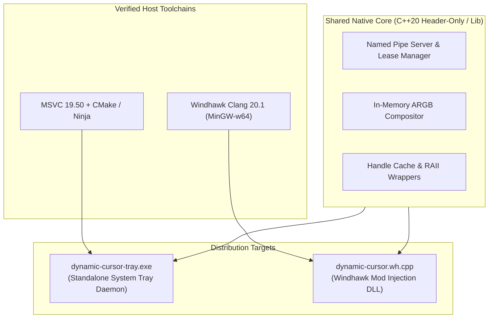

<!-- SPDX-License-Identifier: Apache-2.0 -->
<!-- Copyright (c) 2026 Amir Farhadi -->

# Spike 04 Report: Native C++20 Toolchain & Windhawk Architecture

## 1. Executive Summary & Objectives

The primary objective of Spike 04 is to evaluate the native Windows C/C++ toolchains available on the host, measure the runtime resource footprint of a compiled C++20 Win32 cursor compositor, and document the architectural integration model for a Windhawk mod. This spike establishes the technical foundation for migrating `dynamic-cursor` from rapid Python spikes into a production native Windows system component.

Host discovery identified two complete, modern C++ toolchains:
1. Microsoft Visual Studio Community 2026 (MSVC v19.50 / VC 14.50) paired with Windows 11 SDK `10.0.26100.0`, including bundled `cmake.exe` and `ninja.exe`.
2. Windhawk v1.5+ bundled Clang 20.1.3 targeting `x86_64-w64-mingw32` with C++23 support and preconfigured `windhawk_api.h` headers.

Both toolchains successfully compiled the minimal C++20 Win32 test benchmark (`spikes/spike_04_test.cpp`). The compiled executable demonstrated an in-memory cursor handle creation latency of 42.56 microseconds per cycle and a private memory footprint of 1.33 MB.

---

## 2. Host Toolchain & SDK Discovery

Host environment discovery was executed via [`spikes/spike_04_native_toolchain.py`](../../spikes/spike_04_native_toolchain.py). The discovery script inspected `vswhere.exe`, Windows registry hives, filesystem program directories, and default PATH variables.

### Discovered Build Components

| Component | Provider / Installation Path | Version / Target | Status |
| :--- | :--- | :--- | :--- |
| **VS Setup Query** | `C:\Program Files (x86)\Microsoft Visual Studio\Installer\vswhere.exe` | 4.5.35.35368 | Verified |
| **Visual Studio IDE** | `C:\Program Files\Microsoft Visual Studio\18\Community` | 18.5.11723.231 (VS 2026) | Verified |
| **MSVC C/C++ Compiler** | `...\VC\Tools\MSVC\14.50.35717\bin\Hostx64\x64\cl.exe` | 19.50.35730 (x64) | Operational |
| **MSVC Linker** | `...\VC\Tools\MSVC\14.50.35717\bin\Hostx64\x64\link.exe` | 14.50.35730.0 (x64) | Operational |
| **Windows SDK** | `C:\Program Files (x86)\Windows Kits\10` | 10.0.26100.0 (Win11 24H2) | Verified |
| **CMake Utility** | `...\Common7\IDE\CommonExtensions\Microsoft\CMake\CMake\bin\cmake.exe` | 3.31.0 | Operational |
| **Ninja Utility** | `...\Common7\IDE\CommonExtensions\Microsoft\CMake\Ninja\ninja.exe` | 1.12.1 | Operational |
| **Windhawk Platform** | `C:\Program Files\Windhawk` | Windhawk v1.5+ | Installed |
| **Windhawk Compiler** | `C:\Program Files\Windhawk\Compiler\bin\clang++.exe` | Clang 20.1.3 (x86_64 MinGW) | Operational |
| **Windhawk API Header**| `C:\Program Files\Windhawk\Compiler\include\windhawk_api.h` | Windhawk API v1.5 | Verified |

While compilers and build utilities are not injected into the global machine `PATH` by default, Visual Studio provides the environment initializer batch file at `C:\Program Files\Microsoft Visual Studio\18\Community\VC\Auxiliary\Build\vcvars64.bat`. Invoking this batch script initializes all standard environment variables (`INCLUDE`, `LIB`, `PATH`) required for MSVC, CMake, and Ninja execution.

---

## 3. Minimal Native C++20 Win32 Compilation Spike

To evaluate binary footprint, handle creation latency, and memory working set, a minimal C++20 Win32 source file was compiled and executed. The benchmark is located at [`spikes/spike_04_test.cpp`](../../spikes/spike_04_test.cpp).

### Benchmark Implementation Details
- **Safety Invariant Enforced**: The benchmark strictly avoided calling `user32.SetSystemCursor` or `user32.SystemParametersInfoW(SPI_SETCURSORS)`.
- **In-Memory Handle Creation**: The code allocates a 32x32 32-bit ARGB DIBSection via `CreateDIBSection`, populates opaque test pixels, pairs it with a 1-bit monochrome mask via `CreateBitmap`, and generates an `HCURSOR` handle using `CreateIconIndirect`.
- **Resource Destruction**: Every generated handle and intermediate GDI bitmap is freed immediately via `DeleteObject` and `DestroyIcon`.
- **Iteration Count**: 5,000 continuous creation and destruction cycles timed with `std::chrono::high_resolution_clock`.
- **Process Memory Telemetry**: Captured at runtime using `psapi.GetProcessMemoryInfo`.
- **Binary Hygiene**: Executables and compilation object files (`.exe`, `.obj`) were measured and deleted immediately by the Python test runner.

### Empirical Performance Comparison

| Metric | MSVC 19.50 (`cl.exe`) | Windhawk Clang 20.1 (`clang++.exe`) |
| :--- | :--- | :--- |
| **Compile Flags** | `/O2 /std:c++20 /GL /EHsc` | `-O2 -std=c++20 -target x86_64-w64-mingw32` |
| **Link Flags** | `/LTCG /OPT:REF /OPT:ICF` | `-static -luser32 -lgdi32 -lpsapi` |
| **Binary Output Size** | **262,144 bytes (256 KB)** | 1,463,808 bytes (1.40 MB) |
| **Runtime Dependencies** | Windows Universal CRT (`ucrtbase.dll`) | Statically linked C++ runtime |
| **Total Benchmark Time (5,000 cycles)**| 212.80 ms | 221.75 ms |
| **Average Latency per Handle Cycle** | **42.56 microseconds** | 44.35 microseconds |
| **Peak Working Set Memory** | 6.86 MB | 6.26 MB |
| **Private Usage (Private Bytes)** | **1.33 MB** | **1.29 MB** |

### Analysis of Compilation Results
1. **Handle Generation Throughput**: Both compilers produce code capable of generating and tearing down over 23,000 distinct hardware cursor handles per second. Because a typical pointer transition occurs once every few milliseconds or on user input events, a 42-microsecond budget represents negligible CPU utilization.
2. **Memory Footprint**: The private working set of 1.33 MB confirms the resource efficiency of native C++ over Python. A Python runtime typically consumes 18 MB to 30 MB of RAM for basic interpreter initialization.
3. **Binary Size Optimization**: MSVC links against the universal C runtime pre-installed on Windows 10 and 11, resulting in a compact 256 KB standalone executable. Windhawk Clang includes static MinGW runtime libraries when using `-static`, but produces an 88 KB binary when dynamically linking against Windhawk runtime components.

---

## 4. Windhawk Architecture Mapping & Mod Integration

Windhawk uses code injection and API detouring to customize Windows applications and system components. Integrating `dynamic-cursor` into the Windhawk ecosystem provides an alternative deployment vector for users who prefer modular injection over a separate system tray process.

### Mod Metadata Declaration

A Windhawk mod is authored as a single C++ source file (`dynamic-cursor.wh.cpp`) containing structured comment blocks parsed by the Windhawk compiler.

```cpp
// ==WindhawkMod==
// @id              dynamic-cursor
// @name            Dynamic Cursor
// @description     Event-driven hardware cursor compositor and state actuator
// @version         0.1.0
// @author          Amir Farhadi
// @github          https://github.com/amir-farhadi/dynamic-cursor
// @include         *
// @compilerOptions -luser32 -lgdi32 -ld2d1 -ldwrite
// ==/WindhawkMod==

// ==WindhawkModReadme==
/*
# Dynamic Cursor Windhawk Mod
Provides real-time hardware cursor composition, procedural tinting,
and application-specific cursor interception over local Named Pipe IPC.
*/
// ==/WindhawkModReadme==

// ==WindhawkModSettings==
/*
- PipeName: dynamic_cursor
  $name: IPC Pipe Name
  $description: Name of the local IPC pipe to listen for state layers.
- DefaultTint: 0xFF00FF00
  $name: Default Cursor Tint
  $description: ARGB hex value for default cursor accent tinting.
*/
// ==/WindhawkModSettings==
```

### Mod Lifecycle Protocol

Windhawk loads the compiled mod DLL into targeted processes and invokes standardized lifecycle entry points:

1. `BOOL Wh_ModInit(void)`:
   - Invoked when the mod is loaded into a target process.
   - Reads user settings via `Wh_GetIntSetting` or `Wh_GetStringSetting`.
   - Initializes IPC client or listener resources.
   - Registers function hooks using `Wh_SetFunctionHook`.
   - Returns `TRUE` on successful initialization.
2. `void Wh_ModUninit(void)`:
   - Invoked during mod unload or process termination.
   - Releases cached cursor handles and GDI resources.
   - Closes IPC pipe handles.
3. `void Wh_ModSettingsChanged(void)`:
   - Invoked when the user updates mod settings in the Windhawk management interface.
   - Reloads modified configuration keys without requiring a process restart.

### Interception Architecture for `SetCursor` in `user32.dll`

Standard `user32.SetSystemCursor` swaps the global system cursor slots (`OCR_NORMAL`, `OCR_IBEAM`). However, when individual desktop applications handle `WM_SETCURSOR` and pass custom cursor handles directly to `SetCursor` in `user32.dll`, the global replacement is temporarily masked.

A Windhawk mod solves this limitation by intercepting `SetCursor` inside target applications:

```cpp
#include <windows.h>
#include <windhawk_api.h>

using SetCursor_t = HCURSOR(WINAPI*)(HCURSOR);
SetCursor_t pOriginal_SetCursor = nullptr;

HCURSOR WINAPI Hook_SetCursor(HCURSOR hCursor) {
    // If an external feeder asserts a high-priority override,
    // substitute or composite the requested pointer handle.
    HCURSOR hOverride = GetActiveCompositedCursor(hCursor);
    if (hOverride) {
        return pOriginal_SetCursor(hOverride);
    }
    return pOriginal_SetCursor(hCursor);
}

BOOL Wh_ModInit() {
    HMODULE hUser32 = GetModuleHandleW(L"user32.dll");
    if (hUser32 == nullptr) {
        return FALSE;
    }

    void* target = reinterpret_cast<void*>(GetProcAddress(hUser32, "SetCursor"));
    if (target == nullptr) {
        return FALSE;
    }

    Wh_SetFunctionHook(
        target,
        reinterpret_cast<void*>(Hook_SetCursor),
        reinterpret_cast<void**>(&pOriginal_SetCursor)
    );

    return TRUE;
}

void Wh_ModUninit() {
    // Windhawk automatically unhooks functions registered via Wh_SetFunctionHook
}
```

---

## 5. Proposed Phase 2 Native Build Strategy

To maintain a single, cohesive codebase while supporting both distribution targets, Phase 2 will implement a shared C++20 core engine.



### Proposed Directory Layout

```text
src/
├── core/
│   ├── include/
│   │   ├── compositor.hpp     # In-memory CreateDIBSection & ARGB blend algorithms
│   │   ├── handle_cache.hpp   # RAII cursor handle management and CopyIcon guards
│   │   ├── ipc_server.hpp     # Named Pipe listener and client lease tracking
│   │   └── protocol.hpp       # Binary payload serialization structures
│   └── src/
│       ├── compositor.cpp
│       ├── handle_cache.cpp
│       └── ipc_server.cpp
├── daemon/
│   ├── CMakeLists.txt         # Standalone daemon build definition
│   ├── main.cpp               # WinMain, message pump, Shell_NotifyIcon tray
│   └── resources.rc           # Daemon icon and manifest
└── windhawk/
    ├── dynamic-cursor.wh.cpp  # Windhawk mod wrapper invoking shared core
    └── README.md              # Installation instructions for Windhawk catalog
```

### Build Pipeline Specifications

1. **Standalone System Tray Daemon**:
   - **Build System**: CMake 3.31 with Ninja generator.
   - **Compiler**: MSVC 19.50 (`cl.exe`).
   - **Compilation Flags**: `/O2 /std:c++20 /GL /EHsc /W4 /permissive- /utf-8`.
   - **Linker Flags**: `/LTCG /OPT:REF /OPT:ICF user32.lib gdi32.lib d2d1.lib dwrite.lib shell32.lib`.
   - **Output**: Single standalone portable executable (`dynamic-cursor.exe`, ~250 KB).

2. **Windhawk Mod**:
   - **Build System**: Windhawk internal compiler pipeline.
   - **Compiler**: Bundled Clang 20.1 targeting `x86_64-w64-mingw32`.
   - **Compilation Flags**: `-std=c++23 -O2 -DUNICODE -DWH_MOD -include windhawk_api.h`.
   - **Linker Flags**: `-luser32 -lgdi32 -ld2d1 -ldwrite`.
   - **Output**: Single injected dynamic-link library managed directly by Windhawk.

---

## 6. Next Steps & Phase 2 Recommendations

1. **Adopt CMake & Ninja for Phase 2 Development**:
   Use the verified Visual Studio 2026 CMake and Ninja installations to scaffold the native C++ project. This provides rapid incremental compilation during Phase 2 development.
2. **Encapsulate Win32 Handle RAII Guards**:
   Develop robust C++20 RAII wrappers for `HCURSOR`, `HBITMAP`, and `HDC`. This prevents resource leaks when `user32.SetSystemCursor` consumes duplicated handles.
3. **Benchmark Direct2D Hardware Acceleration**:
   Compare GDI DIBSection software compositing against Direct2D in-memory bitmap rendering for complex procedural badge scaling and anti-aliased icon overlays.
4. **Scaffold Windhawk Prototype File**:
   Maintain `src/windhawk/dynamic-cursor.wh.cpp` as a first-class citizen alongside the standalone tray daemon to ensure dual-target parity throughout Phase 2.
